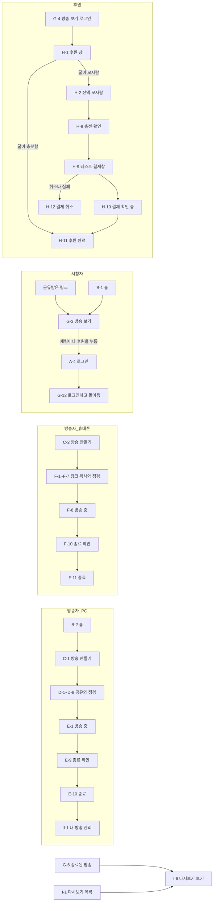

# 나비 화면 설계서

- 작성일: 2026-11-07
- 기준: 피그마 "나비 시안" 파일의 Wireframes 페이지([목차](https://www.figma.com/design/gcj47GzbMmZlBQxZjoLHBp/%EB%82%98%EB%B9%84-%EC%8B%9C%EC%95%88?node-id=108-11417)), [07 기능 명세](07-feature-spec.md)
- 목적: 와이어프레임 181장을 화면 번호 순서로 정리한다. 화면마다 무엇을 보여주는지, 어떤 컴포넌트를 쓰는지 적는다. 개발할 때 이 문서에서 화면 번호를 찾고, 링크로 피그마 화면을 연다.

## 1. 읽는 법

- **화면 번호:** 피그마 와이어프레임의 번호를 그대로 쓴다. 앞 글자는 화면 묶음이고 숫자는 순번이다. 예를 들어 G-12는 "방송 보기" 묶음의 12번째 화면이다.
- **링크:** 화면 번호를 누르면 피그마의 해당 화면이 열린다.
- **기기:** PC 화면은 1440×900, 휴대폰 화면은 375×812다. 모든 화면은 어두운 화면 기준이다.
- **무엇을 보여주나:** 피그마에서 화면 위에 적어 둔 설명을 옮겼다.
- **쓰는 컴포넌트:** 그 화면에 들어간 피그마 컴포넌트 이름이다. 아이콘은 뺐다. 세부 형태(variant, 같은 컴포넌트의 크기·상태 변형)는 피그마에서 확인한다.
- **동작:** 버튼을 누르면 무엇이 일어나는지, 서버가 무엇을 확인하는지는 07 기능 명세에 있다. 이 문서는 동작을 다시 쓰지 않고 07의 절 번호만 적는다.
- **설명 문장:** 화면에는 제목과 값만 둔다. 제목이나 금액 밑에 부연설명 문장을 두지 않는다. 설명이 꼭 필요하면 제목 옆에 "?" 도움말 아이콘(HelpTip)을 두고, 마우스를 올리면 말풍선으로 보여준다. "?"는 한 화면에 한 곳만 둔다. 페이지 제목, 목록의 줄, 나란히 놓인 같은 모양의 카드에는 두지 않는다. 같은 모양이 반복되면 "?"도 반복되기 때문이다. 오류 문구, 빈 화면 문구, 알림 문구, 확인 창 본문, 약관과 후원 안내 같은 법적 문구는 이 규칙에서 빠지고 화면에 그대로 둔다.
- **기준이 다를 때:** 동작은 07이 기준이다. 화면 모양은 피그마가 기준이다. 둘이 다르면 7장에 적고 한쪽을 고친다.

## 2. 화면 묶음

| 묶음 | 화면 | 주소 | 07 기능 명세 | 장 수 |
|---|---|---|---|---|
| A | [로그인 · 회원가입 · 공통](https://www.figma.com/design/gcj47GzbMmZlBQxZjoLHBp/%EB%82%98%EB%B9%84-%EC%8B%9C%EC%95%88?node-id=105-736) | `/login`, `/signup`, 없는 주소 | 4-1 | 16 |
| B | [홈(방송 목록)](https://www.figma.com/design/gcj47GzbMmZlBQxZjoLHBp/%EB%82%98%EB%B9%84-%EC%8B%9C%EC%95%88?node-id=104-230) | `/` | 4-2 | 8 |
| C | [방송 만들기](https://www.figma.com/design/gcj47GzbMmZlBQxZjoLHBp/%EB%82%98%EB%B9%84-%EC%8B%9C%EC%95%88?node-id=105-1827) | `/studio/new` | 4-3 | 8 |
| D | [송출 화면 PC · 시작 전](https://www.figma.com/design/gcj47GzbMmZlBQxZjoLHBp/%EB%82%98%EB%B9%84-%EC%8B%9C%EC%95%88?node-id=106-1627) | `/studio/[방송ID]` | 4-4 | 9 |
| E | [송출 화면 PC · 방송 중과 종료](https://www.figma.com/design/gcj47GzbMmZlBQxZjoLHBp/%EB%82%98%EB%B9%84-%EC%8B%9C%EC%95%88?node-id=106-3283) | `/studio/[방송ID]` | 3장, 4-4 | 16 |
| F | [송출 화면 휴대폰(카메라)](https://www.figma.com/design/gcj47GzbMmZlBQxZjoLHBp/%EB%82%98%EB%B9%84-%EC%8B%9C%EC%95%88?node-id=107-3705) | `/studio/[방송ID]` | 4-5 | 13 |
| G | [방송 보기와 채팅](https://www.figma.com/design/gcj47GzbMmZlBQxZjoLHBp/%EB%82%98%EB%B9%84-%EC%8B%9C%EC%95%88?node-id=107-5149) | `/live/[방송ID]` | 4-6, 4-7 | 25 |
| H | [후원과 충전](https://www.figma.com/design/gcj47GzbMmZlBQxZjoLHBp/%EB%82%98%EB%B9%84-%EC%8B%9C%EC%95%88?node-id=108-5792) | 방송 보기 위에 뜨는 창, `/charge/success`, `/charge/fail` | 4-8 | 18 |
| I | [다시보기](https://www.figma.com/design/gcj47GzbMmZlBQxZjoLHBp/%EB%82%98%EB%B9%84-%EC%8B%9C%EC%95%88?node-id=108-7496) | `/replays`, `/replays/[녹화ID]` | 4-9 | 9 |
| J | [내 방송 관리](https://www.figma.com/design/gcj47GzbMmZlBQxZjoLHBp/%EB%82%98%EB%B9%84-%EC%8B%9C%EC%95%88?node-id=108-8430) | `/studio` | 4-10 | 11 |
| K | [내 꿀](https://www.figma.com/design/gcj47GzbMmZlBQxZjoLHBp/%EB%82%98%EB%B9%84-%EC%8B%9C%EC%95%88?node-id=121-8762) | `/me/honey` | 4-8, 4-11 | 5 |
| L | [내 등급](https://www.figma.com/design/gcj47GzbMmZlBQxZjoLHBp/%EB%82%98%EB%B9%84-%EC%8B%9C%EC%95%88?node-id=125-8938) | `/me/grade` | 4-12 | 3 |
| M | [비밀번호 찾기와 약관](https://www.figma.com/design/gcj47GzbMmZlBQxZjoLHBp/%EB%82%98%EB%B9%84-%EC%8B%9C%EC%95%88?node-id=134-9389) | `/reset-password`, `/terms`, `/terms/streamer`, `/privacy` | 4-1 | 7 |
| N | [내 정보](https://www.figma.com/design/gcj47GzbMmZlBQxZjoLHBp/%EB%82%98%EB%B9%84-%EC%8B%9C%EC%95%88?node-id=136-9355) | `/me` | 4-11 | 12 |
| O | [운영자 화면](https://www.figma.com/design/gcj47GzbMmZlBQxZjoLHBp/%EB%82%98%EB%B9%84-%EC%8B%9C%EC%95%88?node-id=145-9954) | `/admin` 아래 (PC만) | 4-13, 4-15 | 21 |

## 3. 화면 흐름도

화면 번호로 그린 기본 흐름이다. 오류와 예외 화면은 4장의 표에 있다.

## 4. 화면별 설계

### A. 로그인 · 회원가입 · 공통

- **공통 헤더(Header):** 왼쪽은 사이드바 열기 버튼, 로고, 메뉴 링크(전체 방송, 다시보기)다. 로그인 후 오른쪽은 스튜디오(내 방송 관리), 꿀(내 꿀), 알림, 밝은·어두운 화면 전환, 내 프로필이다. 로그인 전에는 화면 전환과 로그인 버튼만 둔다. 휴대폰은 사이드바 열기, 로고, 알림, 프로필만 둔다. 헤더 원본을 고쳤으므로 모든 화면에 함께 반영됐다. 운영자 화면(O)에는 헤더가 없다. 동작은 07 4-16(헤더, 사이드바, 프로필 메뉴)과 4-17(알림)에 있다.

- **주소:** `/login`, `/signup`, 없는 주소
- **동작:** 07 기능 명세 4-1
- **피그마:** [A 묶음 열기](https://www.figma.com/design/gcj47GzbMmZlBQxZjoLHBp/%EB%82%98%EB%B9%84-%EC%8B%9C%EC%95%88?node-id=105-736)

| 번호 | 상태 | 기기 | 무엇을 보여주나 | 쓰는 컴포넌트 |
|---|---|---|---|---|
| [A-1](https://www.figma.com/design/gcj47GzbMmZlBQxZjoLHBp/%EB%82%98%EB%B9%84-%EC%8B%9C%EC%95%88?node-id=105-740) | 로그인 · 기본 | PC | /login. "로그인" 제목과 설명 문장은 두지 않습니다. 누가 봐도 로그인 화면이기 때문입니다. 위에서부터 로고, 입력 칸, "비밀번호 찾기", 로그인 버튼, "Google로 계속하기" 버튼, 회원가입, 심사용 테스트 계정 순서로 둡니다. 구글 버튼은 처음 쓰는 사람의 가입도 함께 합니다(07 4-1). 테스트 계정 버튼은 방송자, 시청자, 운영자 세 개입니다. 두 계정 이상이 있어야 "방송 소유자"와 "다른 사용자"를 나눠 확인할 수 있습니다. | Header, Logo/Nabi, Input, Button |
| [A-2](https://www.figma.com/design/gcj47GzbMmZlBQxZjoLHBp/%EB%82%98%EB%B9%84-%EC%8B%9C%EC%95%88?node-id=105-843) | 로그인 · 휴대폰 | 휴대폰 | 휴대폰은 카드 없이 화면 전체를 씁니다. 배치는 PC(A-1)와 같습니다. | Header, Logo/Nabi, Input, Button |
| [A-3](https://www.figma.com/design/gcj47GzbMmZlBQxZjoLHBp/%EB%82%98%EB%B9%84-%EC%8B%9C%EC%95%88?node-id=105-956) | 로그인 · 틀린 비밀번호 | PC | 이유는 입력 칸 아래에 보여줍니다. 어느 쪽이 틀렸는지는 알려주지 않습니다. | Header, Logo/Nabi, Input, Button |
| [A-4](https://www.figma.com/design/gcj47GzbMmZlBQxZjoLHBp/%EB%82%98%EB%B9%84-%EC%8B%9C%EC%95%88?node-id=105-1062) | 로그인 · 하던 일에서 넘어옴 | PC | 비로그인 사용자가 채팅 입력 칸이나 후원하기를 누르면 이 화면으로 옵니다. 로그인하면 보던 방송으로 돌아가고, 쓰던 채팅은 그대로 남아 있습니다(G-12). | Header, Logo/Nabi, Banner, Input, Button |
| [A-5](https://www.figma.com/design/gcj47GzbMmZlBQxZjoLHBp/%EB%82%98%EB%B9%84-%EC%8B%9C%EC%95%88?node-id=105-1225) | 로그인 · 확인 중 | PC | 로그인 버튼을 누른 뒤 서버 응답을 기다리는 동안 버튼에 회전 표시를 보여주고 다시 누르지 못하게 합니다. 기다리는 동안 "Google로 계속하기" 버튼도 누르지 못하게 합니다. | Header, Logo/Nabi, Input, Button |
| [A-6](https://www.figma.com/design/gcj47GzbMmZlBQxZjoLHBp/%EB%82%98%EB%B9%84-%EC%8B%9C%EC%95%88?node-id=105-1316) | 회원가입 · 기본 | PC | /signup. 이메일, 비밀번호, 비밀번호 확인, 닉네임을 받고 필수 약관 네 가지(만 14세, 이용약관, 방송자 이용약관, 개인정보)에 동의받습니다. 처음에는 아무것도 체크되지 않았고 가입 버튼이 눌리지 않습니다. 가입하면 로그인된 상태로 원래 화면(없으면 홈)으로 갑니다. 비밀번호 칸 두 개에는 눈 아이콘이 있어 누르면 입력한 글자가 보입니다. 닉네임 칸 옆에 "중복 확인" 버튼이 있고, 확인을 통과해야 가입 버튼이 눌립니다(07 4-1). | Header, Input, Button, ConsentItem |
| [A-7](https://www.figma.com/design/gcj47GzbMmZlBQxZjoLHBp/%EB%82%98%EB%B9%84-%EC%8B%9C%EC%95%88?node-id=105-1388) | 회원가입 · 입력 오류 | PC | 이미 가입된 이메일, 6자 미만 비밀번호, 같지 않은 비밀번호 확인, 빈 닉네임을 각 칸 아래에 알려줍니다. 닉네임이 비어 있어 중복 확인 버튼은 눌리지 않습니다. 약관은 모두 동의한 상태입니다. | Header, Input, Button, ConsentItem |
| [A-8](https://www.figma.com/design/gcj47GzbMmZlBQxZjoLHBp/%EB%82%98%EB%B9%84-%EC%8B%9C%EC%95%88?node-id=105-1496) | 회원가입 · 휴대폰 | 휴대폰 | 휴대폰은 카드 없이 화면 전체를 씁니다. 입력 칸, 약관 동의, 오류 안내는 PC(A-6, A-7)와 같습니다. | Header, Input, Button, ConsentItem |
| [A-9](https://www.figma.com/design/gcj47GzbMmZlBQxZjoLHBp/%EB%82%98%EB%B9%84-%EC%8B%9C%EC%95%88?node-id=105-1580) | 프로필 메뉴 열림 | PC | 로그인 상태에서 오른쪽 위 내 프로필을 누르면 열립니다. 위쪽에 프로필 사진, 닉네임, 등급, 이메일을 보여줍니다. 스튜디오, 내 정보, 내 꿀, 내 등급, 내 후원 내역, 내 신고 내역, 제재 내역, 로그아웃이 있습니다. 운영자 화면 항목은 운영자 계정에만 보입니다. | Header, ProfileMenu |
| [A-10](https://www.figma.com/design/gcj47GzbMmZlBQxZjoLHBp/%EB%82%98%EB%B9%84-%EC%8B%9C%EC%95%88?node-id=105-1676) | 로그아웃 직후 | PC | 로그아웃하면 홈으로 가고 아래에 알림 문구를 4초 보여줍니다. 헤더는 로그인 버튼으로 바뀝니다. | Header, Skeleton, Toast |
| [A-11](https://www.figma.com/design/gcj47GzbMmZlBQxZjoLHBp/%EB%82%98%EB%B9%84-%EC%8B%9C%EC%95%88?node-id=105-1733) | 없는 주소 (404) | PC | 지워졌거나 잘못된 방송·다시보기 주소를 열었을 때입니다. 다른 방송을 보러 갈 수 있게 버튼을 하나 둡니다. | Header, EmptyState |
| [A-12](https://www.figma.com/design/gcj47GzbMmZlBQxZjoLHBp/%EB%82%98%EB%B9%84-%EC%8B%9C%EC%95%88?node-id=105-1777) | 없는 주소 · 휴대폰 | 휴대폰 | 휴대폰에서 없는 주소를 열었을 때입니다. 다른 방송을 보러 갈 버튼을 하나 둡니다. | Header, EmptyState |
| [A-13](https://www.figma.com/design/gcj47GzbMmZlBQxZjoLHBp/%EB%82%98%EB%B9%84-%EC%8B%9C%EC%95%88?node-id=152-11715) | 로그인 · 영구 정지 계정 | PC | 영구 정지된 계정으로 로그인하면 정지 안내와 이의 제기 안내 이메일 주소를 보여줍니다. 로그인할 수 없으므로 화면 안에서는 이의를 제기할 수 없습니다. 이메일 주소는 임시값입니다. | Header, Logo/Nabi, Banner, Input, Button |
| [A-14](https://www.figma.com/design/gcj47GzbMmZlBQxZjoLHBp/%EB%82%98%EB%B9%84-%EC%8B%9C%EC%95%88?node-id=159-18894) | 알림 열림 | PC | 헤더의 알림 버튼을 누르면 열립니다. 나비에서 일어난 일만 알립니다. 후원 받음, 미션 결과, 정산 지급, 승급, 신고 처리 결과, 이의 제기 결과입니다. 읽지 않은 알림이 있으면 알림 버튼에 점을 띄웁니다. | Header, NotificationPanel |
| [A-15](https://www.figma.com/design/gcj47GzbMmZlBQxZjoLHBp/%EB%82%98%EB%B9%84-%EC%8B%9C%EC%95%88?node-id=159-18980) | 사이드바 열림 | PC | 헤더 왼쪽의 사이드바 열기 버튼을 누르면 왼쪽에서 사이드바가 열립니다. 메뉴(전체 방송, 다시보기), 지금 방송 중인 채널, 꿀 충전 안내가 있습니다. 채널은 홈과 같이 방송 중 먼저, 최근에 켠 순서입니다. 다시 누르거나 바깥을 누르면 닫힙니다. | Header, Sidebar |
| [A-16](https://www.figma.com/design/gcj47GzbMmZlBQxZjoLHBp/%EB%82%98%EB%B9%84-%EC%8B%9C%EC%95%88?node-id=159-19065) | 사이드바 · 휴대폰 | 휴대폰 | 휴대폰에서는 헤더에 사이드바 열기, 로고, 알림, 프로필만 둡니다. 그래서 스튜디오, 내 꿀, 화면 전환을 사이드바 위쪽에 더합니다. 나머지 구성은 PC와 같습니다. | Header, Sidebar |

### B. 홈(방송 목록)

- **주소:** `/`
- **동작:** 07 기능 명세 4-2
- **피그마:** [B 묶음 열기](https://www.figma.com/design/gcj47GzbMmZlBQxZjoLHBp/%EB%82%98%EB%B9%84-%EC%8B%9C%EC%95%88?node-id=104-230)

| 번호 | 상태 | 기기 | 무엇을 보여주나 | 쓰는 컴포넌트 |
|---|---|---|---|---|
| [B-1](https://www.figma.com/design/gcj47GzbMmZlBQxZjoLHBp/%EB%82%98%EB%B9%84-%EC%8B%9C%EC%95%88?node-id=104-234) | 기본 · 비로그인 | PC | 방송 중 4개, 준비 2개. 비로그인도 목록을 보고 카드를 눌러 바로 시청합니다. 방송하기를 누르면 로그인 화면으로 갑니다. | Header, Button, BroadcastCard |
| [B-2](https://www.figma.com/design/gcj47GzbMmZlBQxZjoLHBp/%EB%82%98%EB%B9%84-%EC%8B%9C%EC%95%88?node-id=104-469) | 기본 · 로그인 | PC | 헤더 오른쪽에 스튜디오, 꿀, 알림, 화면 전환, 내 프로필이 생깁니다. 프로필을 누르면 메뉴(A-9)가 열립니다. 방송하기 버튼은 목록 위쪽에 있습니다. | Header, Button, BroadcastCard |
| [B-3](https://www.figma.com/design/gcj47GzbMmZlBQxZjoLHBp/%EB%82%98%EB%B9%84-%EC%8B%9C%EC%95%88?node-id=104-686) | 기본 · 휴대폰 | 휴대폰 | 휴대폰에서는 한 줄 카드로 세로로 쌓습니다. | Header, Button, BroadcastCard |
| [B-4](https://www.figma.com/design/gcj47GzbMmZlBQxZjoLHBp/%EB%82%98%EB%B9%84-%EC%8B%9C%EC%95%88?node-id=104-1002) | 빈 목록 | PC | 방송 중과 준비 중인 방송이 하나도 없을 때입니다. 목록 자리 안에 빈 화면을 보여주고, 방송하기 버튼을 둡니다. | Header, Button, EmptyState |
| [B-5](https://www.figma.com/design/gcj47GzbMmZlBQxZjoLHBp/%EB%82%98%EB%B9%84-%EC%8B%9C%EC%95%88?node-id=104-1074) | 불러오는 중 | PC | 320ms 안에 끝나면 아무것도 보여주지 않습니다. 더 걸리면 카드 자리만 잡아 둔 뼈대를 보여줍니다. 뼈대는 움직이지 않습니다. | Header, Button, Skeleton |
| [B-6](https://www.figma.com/design/gcj47GzbMmZlBQxZjoLHBp/%EB%82%98%EB%B9%84-%EC%8B%9C%EC%95%88?node-id=104-1143) | 불러오기 실패 | PC | 목록을 받아오지 못했을 때입니다. 무엇이 안 됐는지와 다시 시도 버튼을 보여줍니다. | Header, Button, EmptyState |
| [B-7](https://www.figma.com/design/gcj47GzbMmZlBQxZjoLHBp/%EB%82%98%EB%B9%84-%EC%8B%9C%EC%95%88?node-id=104-1199) | 빈 목록 · 휴대폰 | 휴대폰 | 휴대폰 빈 목록입니다. | Header, Button, EmptyState |
| [B-8](https://www.figma.com/design/gcj47GzbMmZlBQxZjoLHBp/%EB%82%98%EB%B9%84-%EC%8B%9C%EC%95%88?node-id=152-11820) | 경고 안내 띠 | PC | 운영자에게 경고를 받은 사용자가 다음에 로그인하면 위쪽에 경고 띠를 한 번 보여줍니다. 이용 제한은 없습니다. "자세히 보기"는 내 정보의 제재 내역(N-10)으로 갑니다. | Header, Banner, Button, BroadcastCard |

### C. 방송 만들기

- **주소:** `/studio/new`
- **동작:** 07 기능 명세 4-3
- **피그마:** [C 묶음 열기](https://www.figma.com/design/gcj47GzbMmZlBQxZjoLHBp/%EB%82%98%EB%B9%84-%EC%8B%9C%EC%95%88?node-id=105-1827)

| 번호 | 상태 | 기기 | 무엇을 보여주나 | 쓰는 컴포넌트 |
|---|---|---|---|---|
| [C-1](https://www.figma.com/design/gcj47GzbMmZlBQxZjoLHBp/%EB%82%98%EB%B9%84-%EC%8B%9C%EC%95%88?node-id=105-1831) | 기본 · PC | PC | PC에서는 "PC 화면 공유"가 기본 선택입니다. "PC 화면 공유" 아래에 "내 얼굴도 같이 보여주기" 스위치가 있습니다(06 결정 15). | Header, Input, SourceCard, Switch, Button |
| [C-2](https://www.figma.com/design/gcj47GzbMmZlBQxZjoLHBp/%EB%82%98%EB%B9%84-%EC%8B%9C%EC%95%88?node-id=105-1956) | 기본 · 휴대폰 | 휴대폰 | 카메라가 기본 선택이고, 화면 공유 카드는 눌리지 않는 상태로 이유를 적습니다. | Header, Input, SourceCard, Switch, Button |
| [C-4](https://www.figma.com/design/gcj47GzbMmZlBQxZjoLHBp/%EB%82%98%EB%B9%84-%EC%8B%9C%EC%95%88?node-id=105-2197) | 제목 비움 | PC | 제목을 지우고 만들기를 누르면 칸 아래에 이유를 보여줍니다. | Header, Input, SourceCard, Switch, Button |
| [C-5](https://www.figma.com/design/gcj47GzbMmZlBQxZjoLHBp/%EB%82%98%EB%B9%84-%EC%8B%9C%EC%95%88?node-id=105-2324) | 제목 50자 넘음 | PC | 50자를 넘으면 글자 수를 빨간색으로 바꾸고 이유를 보여줍니다. | Header, Input, SourceCard, Switch, Button |
| [C-6](https://www.figma.com/design/gcj47GzbMmZlBQxZjoLHBp/%EB%82%98%EB%B9%84-%EC%8B%9C%EC%95%88?node-id=105-2451) | 만드는 중 | PC | 서버 저장을 기다리는 동안 버튼에 회전 표시를 보여주고 두 번 누르지 못하게 합니다. | Header, Input, SourceCard, Switch, Button |
| [C-7](https://www.figma.com/design/gcj47GzbMmZlBQxZjoLHBp/%EB%82%98%EB%B9%84-%EC%8B%9C%EC%95%88?node-id=105-2566) | 만들기 실패 | PC | 서버 저장이 실패하면 알림 문구로 알려주고 입력값은 그대로 둡니다. | Header, Input, SourceCard, Switch, Button, Toast |
| [C-8](https://www.figma.com/design/gcj47GzbMmZlBQxZjoLHBp/%EB%82%98%EB%B9%84-%EC%8B%9C%EC%95%88?node-id=105-2708) | 비로그인으로 들어옴 | PC | 헤더의 스튜디오나 홈의 방송하기를 비로그인으로 누르면 로그인 화면으로 갑니다. 로그인하면 홈의 방송하기는 방송 만들기로, 헤더의 스튜디오는 내 방송 관리(`/studio`)로 돌아옵니다(07 4-16). | Header, Banner, Input, Button |
| [C-9](https://www.figma.com/design/gcj47GzbMmZlBQxZjoLHBp/%EB%82%98%EB%B9%84-%EC%8B%9C%EC%95%88?node-id=152-11973) | 방송 금지 중 | PC | 운영자가 방송 금지를 건 방송자입니다. 위쪽에 안내 띠를 보여주고 "방송 만들기" 버튼을 막습니다. 서버도 방송 만들기와 송출 시작을 거절합니다. 채팅과 시청은 할 수 있습니다. | Header, Banner, Input, SourceCard, Switch, Button |

### D. 송출 화면 PC · 시작 전

- **주소:** `/studio/[방송ID]`
- **동작:** 07 기능 명세 4-4
- **피그마:** [D 묶음 열기](https://www.figma.com/design/gcj47GzbMmZlBQxZjoLHBp/%EB%82%98%EB%B9%84-%EC%8B%9C%EC%95%88?node-id=106-1627)

| 번호 | 상태 | 기기 | 무엇을 보여주나 | 쓰는 컴포넌트 |
|---|---|---|---|---|
| [D-1](https://www.figma.com/design/gcj47GzbMmZlBQxZjoLHBp/%EB%82%98%EB%B9%84-%EC%8B%9C%EC%95%88?node-id=106-1631) | 공유 전 안내 | PC | "화면 공유 시작"을 누르기 전에 세 가지를 그림과 함께 먼저 보여줍니다. | Header, Stepper, Button, ChatInput |
| [D-2](https://www.figma.com/design/gcj47GzbMmZlBQxZjoLHBp/%EB%82%98%EB%B9%84-%EC%8B%9C%EC%95%88?node-id=106-1783) | 브라우저 공유 창 | PC | "화면 공유 시작"을 누르면 Chrome이 공유 창을 띄웁니다. 우리 말풍선으로 탭 오디오 공유를 한 번 더 알려줍니다. | Header, Stepper, Button, ChatInput, Chip, Switch, Tooltip |
| [D-3](https://www.figma.com/design/gcj47GzbMmZlBQxZjoLHBp/%EB%82%98%EB%B9%84-%EC%8B%9C%EC%95%88?node-id=106-1976) | 화면 공유 거부 · 취소 | PC | 공유 창에서 취소를 누르거나 권한이 막혔을 때입니다. 이유와 다시 켜는 방법을 보여줍니다. | Header, Stepper, Button, ChatInput |
| [D-4](https://www.figma.com/design/gcj47GzbMmZlBQxZjoLHBp/%EB%82%98%EB%B9%84-%EC%8B%9C%EC%95%88?node-id=106-2088) | 마이크 권한 요청 | PC | 화면 공유가 시작되면 마이크 권한을 묻습니다. 권한 창 옆에 "허용을 눌러 주세요"를 먼저 띄웁니다. | Header, Stepper, Tooltip, MicMeter, ChecklistItem, Button, ChatInput |
| [D-5](https://www.figma.com/design/gcj47GzbMmZlBQxZjoLHBp/%EB%82%98%EB%B9%84-%EC%8B%9C%EC%95%88?node-id=106-2322) | 미리보기 · 모두 정상 | PC | 공유한 화면을 보여주고, 탭 소리 막대와 마이크 소리 막대를 따로 보여줍니다. 마이크는 목록에서 바꿀 수 있습니다. "방송 시작" 바로 위에 "이 방송 녹화하기" 스위치와 "?" 도움말이 있습니다. 기본은 꺼짐이고, 방송이 시작되면 바꿀 수 없습니다. 도움말에는 3분 제한을 적습니다(06 결정 24, 29). | Header, Stepper, MicMeter, ChecklistItem, Select, Button, ChatInput |
| [D-6](https://www.figma.com/design/gcj47GzbMmZlBQxZjoLHBp/%EB%82%98%EB%B9%84-%EC%8B%9C%EC%95%88?node-id=106-2492) | 탭 소리 없음 | PC | 공유에 소리가 없으면(탭 오디오 공유를 끄면) 점검 목록에서 알리고 "다시 공유" 버튼을 줍니다. 방송 시작은 막지 않습니다. | Header, Stepper, MicMeter, ChecklistItem, Button, ChatInput |
| [D-7](https://www.figma.com/design/gcj47GzbMmZlBQxZjoLHBp/%EB%82%98%EB%B9%84-%EC%8B%9C%EC%95%88?node-id=106-2684) | 마이크 거부 | PC | 마이크를 막으면 경고 띠로 다시 켜는 방법을 알려줍니다. 마이크 없이도 방송은 시작할 수 있습니다. | Header, Stepper, Banner, MicMeter, ChecklistItem, Button, ChatInput |
| [D-8](https://www.figma.com/design/gcj47GzbMmZlBQxZjoLHBp/%EB%82%98%EB%B9%84-%EC%8B%9C%EC%95%88?node-id=106-2905) | 방송 시작 중 | PC | "방송 시작"을 누르면 서버가 소유자를 확인하고 송출용 접속 권한을 줍니다. 그동안 버튼에 회전 표시를 보여줍니다. | Header, Stepper, MicMeter, ChecklistItem, Button, ChatInput |
| [D-9](https://www.figma.com/design/gcj47GzbMmZlBQxZjoLHBp/%EB%82%98%EB%B9%84-%EC%8B%9C%EC%95%88?node-id=106-3070) | 방송 시작 실패 | PC | 서버나 송출 연결이 실패하면 알림 문구로 알리고 미리보기 상태로 돌아옵니다. 상태는 준비 그대로입니다. | Header, Stepper, MicMeter, ChecklistItem, Button, ChatInput, Toast |

### E. 송출 화면 PC · 방송 중과 종료

- **주소:** `/studio/[방송ID]`
- **동작:** 07 기능 명세 3장, 4-4
- **피그마:** [E 묶음 열기](https://www.figma.com/design/gcj47GzbMmZlBQxZjoLHBp/%EB%82%98%EB%B9%84-%EC%8B%9C%EC%95%88?node-id=106-3283)

| 번호 | 상태 | 기기 | 무엇을 보여주나 | 쓰는 컴포넌트 |
|---|---|---|---|---|
| [E-1](https://www.figma.com/design/gcj47GzbMmZlBQxZjoLHBp/%EB%82%98%EB%B9%84-%EC%8B%9C%EC%95%88?node-id=106-3287) | 방송 중 · 막 켜짐 | PC | 상태가 방송 중으로 바뀌면 알림 문구로 바로 알려줍니다. 홈 목록 맨 위에 이 방송이 올라갑니다. "시청자 화면으로 보기"를 누르면 방송 보기 화면을 소리를 끈 새 탭으로 엽니다. 열린 화면은 H-14와 같습니다. 이 버튼은 E-1~E-7, E-14에 모두 있습니다. | Header, StatusBadge, IconButton, Button, BroadcastControls, ChatInput, Toast |
| [E-2](https://www.figma.com/design/gcj47GzbMmZlBQxZjoLHBp/%EB%82%98%EB%B9%84-%EC%8B%9C%EC%95%88?node-id=106-3426) | 방송 중 · 채팅과 후원 도착 | PC | 후원이 확정되면 영상 위에 후원 알림이 잠깐 뜨고 채팅 목록에도 남습니다. | Header, StatusBadge, IconButton, Button, DonationAlert, BroadcastControls, CommentItem, DonationItem, ChatInput |
| [E-3](https://www.figma.com/design/gcj47GzbMmZlBQxZjoLHBp/%EB%82%98%EB%B9%84-%EC%8B%9C%EC%95%88?node-id=106-3601) | 방송 중 · 큰 후원 | PC | 10만 꿀 이상 후원은 알림을 크게 보여줍니다. | Header, StatusBadge, IconButton, Button, DonationAlert, BroadcastControls, CommentItem, DonationItem, ChatInput |
| [E-4](https://www.figma.com/design/gcj47GzbMmZlBQxZjoLHBp/%EB%82%98%EB%B9%84-%EC%8B%9C%EC%95%88?node-id=106-3803) | 방송 중 · 제목 수정 | PC | 연필 버튼을 누르면 제목이 입력 칸으로 바뀝니다. 저장하면 시청자 화면과 홈 목록에 바로 반영됩니다. | Header, StatusBadge, Input, Button, BroadcastControls, CommentItem, DonationItem, ChatInput |
| [E-5](https://www.figma.com/design/gcj47GzbMmZlBQxZjoLHBp/%EB%82%98%EB%B9%84-%EC%8B%9C%EC%95%88?node-id=106-3976) | 방송 중 · 마이크 조용함 | PC | 마이크 소리가 8초 동안 없으면 경고 띠를 띄웁니다. "괜찮아요"를 누르면 이 방송이 끝날 때까지 다시 띄우지 않습니다. 시청자 화면에는 보이지 않습니다. | Header, StatusBadge, IconButton, Button, Banner, BroadcastControls, CommentItem, DonationItem, ChatInput |
| [E-6](https://www.figma.com/design/gcj47GzbMmZlBQxZjoLHBp/%EB%82%98%EB%B9%84-%EC%8B%9C%EC%95%88?node-id=106-4155) | 방송 중 · 녹화 실패 | PC | 녹화를 켰는데 시작하지 못하면(무료 한도 초과, 오류) 알려줍니다. 방송은 그대로 계속됩니다. | Header, StatusBadge, IconButton, Button, Banner, BroadcastControls, CommentItem, DonationItem, ChatInput |
| [E-7](https://www.figma.com/design/gcj47GzbMmZlBQxZjoLHBp/%EB%82%98%EB%B9%84-%EC%8B%9C%EC%95%88?node-id=106-4353) | 방송 중 · 마이크 끔 | PC | 방송자가 마이크 버튼으로 마이크를 끈 상태입니다. 탭 소리는 계속 나갑니다. | Header, StatusBadge, IconButton, Button, BroadcastControls, CommentItem, DonationItem, ChatInput |
| [E-8](https://www.figma.com/design/gcj47GzbMmZlBQxZjoLHBp/%EB%82%98%EB%B9%84-%EC%8B%9C%EC%95%88?node-id=106-4550) | 방송 중 · 다른 화면으로 이동 | PC | 방송 중에 서비스 안의 다른 화면으로 가려 하면 확인 창을 띄웁니다. 탭을 닫거나 새로 고칠 때는 브라우저 기본 창이 뜨고, 그 창의 문구는 바꿀 수 없습니다. | Header, StatusBadge, IconButton, Button, BroadcastControls, CommentItem, DonationItem, ChatInput, Dialog |
| [E-9](https://www.figma.com/design/gcj47GzbMmZlBQxZjoLHBp/%EB%82%98%EB%B9%84-%EC%8B%9C%EC%95%88?node-id=106-4762) | 방송 종료 확인 | PC | "방송 종료"를 누르면 확인 창을 띄웁니다. 처음 초점은 취소에 둡니다. | Header, StatusBadge, IconButton, Button, BroadcastControls, CommentItem, DonationItem, ChatInput, Dialog |
| [E-10](https://www.figma.com/design/gcj47GzbMmZlBQxZjoLHBp/%EB%82%98%EB%B9%84-%EC%8B%9C%EC%95%88?node-id=106-4948) | 종료됨 · 녹화 있음 | PC | 종료하면 이 화면으로 바뀝니다. 녹화를 켰다면 다시보기를 만드는 중이라고 함께 보여줍니다. 채팅 목록은 남고 입력은 막힙니다. | Header, StatusBadge, Spinner, Button, CommentItem, DonationItem, ChatInput |
| [E-11](https://www.figma.com/design/gcj47GzbMmZlBQxZjoLHBp/%EB%82%98%EB%B9%84-%EC%8B%9C%EC%95%88?node-id=106-5109) | 종료됨 · 공유 중지로 끝남 | PC | Chrome의 "공유 중지"를 누르면 송출 화면이 알아채고 종료를 요청합니다. 녹화가 없으면 다시보기 안내는 없습니다. | Header, StatusBadge, Button, CommentItem, DonationItem, ChatInput |
| [E-12](https://www.figma.com/design/gcj47GzbMmZlBQxZjoLHBp/%EB%82%98%EB%B9%84-%EC%8B%9C%EC%95%88?node-id=106-5264) | 종료된 방송의 송출 화면을 다시 열었을 때 | PC | 탭을 닫았거나 네트워크가 끊겨 서버가 종료한 방송의 송출 주소를 다시 열면 이 화면입니다. | Header, StatusBadge, Button, CommentItem, DonationItem, ChatInput |
| [E-13](https://www.figma.com/design/gcj47GzbMmZlBQxZjoLHBp/%EB%82%98%EB%B9%84-%EC%8B%9C%EC%95%88?node-id=106-5419) | 다른 사용자가 송출 주소를 열었을 때 (403) | PC | 방송 소유자가 아닌 사용자가 송출 화면 주소를 열면 거절합니다. 서버도 송출용 접속 권한을 주지 않습니다. | Header, EmptyState |
| [E-14](https://www.figma.com/design/gcj47GzbMmZlBQxZjoLHBp/%EB%82%98%EB%B9%84-%EC%8B%9C%EC%95%88?node-id=120-10158) | 방송 중 · 미션 목록 | PC | 채팅 영역 위쪽 탭에서 미션 목록으로 바꿉니다. 대기 중인 미션은 수락과 거절, 진행 중인 미션은 성공과 실패를 누릅니다. 방송이 끝나면 대기 중인 미션은 "취소됨"으로 꿀을 모두 돌려주고, 진행 중인 미션은 "실패"로 응원금 20%만 방송자에게 주고 나머지를 돌려줍니다(07 3장, 4-8). | Header, StatusBadge, Button, DonationAlert, BroadcastControls, Tab, MissionCard, ChatInput |
| [E-15](https://www.figma.com/design/gcj47GzbMmZlBQxZjoLHBp/%EB%82%98%EB%B9%84-%EC%8B%9C%EC%95%88?node-id=152-12076) | 사용자 시트 · 방송자 | PC | 방송자가 자기 송출 화면의 채팅에서 닉네임을 누르면 사용자 시트가 열립니다. 시청자 시트(G-19)에 "이 방송에서 채팅 금지"가 더해집니다. 방송자 자신과 운영자에게는 이 항목이 보이지 않습니다. | Header, StatusBadge, IconButton, Button, DonationAlert, BroadcastControls, CommentItem, DonationItem, ChatInput, GradeBadge, MenuItem, BottomSheet |
| [E-16](https://www.figma.com/design/gcj47GzbMmZlBQxZjoLHBp/%EB%82%98%EB%B9%84-%EC%8B%9C%EC%95%88?node-id=152-12148) | 활동 제한 걸기 | PC | "이 방송에서 채팅 금지"를 누르면 기간과 메모를 받습니다. 기간은 1일, 7일, 영구입니다. 제한은 이 방송자의 모든 방송에 적용되고, 내 방송 관리의 활동 제한 탭(J-12)에서 풀 수 있습니다. | Header, StatusBadge, IconButton, Button, DonationAlert, BroadcastControls, CommentItem, DonationItem, ChatInput, Chip, Textarea |

### F. 송출 화면 휴대폰(카메라)

- **주소:** `/studio/[방송ID]`
- **동작:** 07 기능 명세 4-5
- **피그마:** [F 묶음 열기](https://www.figma.com/design/gcj47GzbMmZlBQxZjoLHBp/%EB%82%98%EB%B9%84-%EC%8B%9C%EC%95%88?node-id=107-3705)

| 번호 | 상태 | 기기 | 무엇을 보여주나 | 쓰는 컴포넌트 |
|---|---|---|---|---|
| [F-1](https://www.figma.com/design/gcj47GzbMmZlBQxZjoLHBp/%EB%82%98%EB%B9%84-%EC%8B%9C%EC%95%88?node-id=107-3709) | 링크 먼저 복사 | 휴대폰 | 송출 화면에 처음 들어오면 링크부터 복사하게 합니다. | Header, Stepper, Banner, Button |
| [F-2](https://www.figma.com/design/gcj47GzbMmZlBQxZjoLHBp/%EB%82%98%EB%B9%84-%EC%8B%9C%EC%95%88?node-id=107-3853) | 권한 안내 | 휴대폰 | 기기 권한 창이 뜨기 전에 무엇을 누를지 먼저 보여줍니다. | Header, Stepper, Button |
| [F-3](https://www.figma.com/design/gcj47GzbMmZlBQxZjoLHBp/%EB%82%98%EB%B9%84-%EC%8B%9C%EC%95%88?node-id=107-3921) | 기기 권한 창 | 휴대폰 | "카메라 켜기"를 누르면 아이폰이 권한 창을 띄웁니다. | Header, Stepper |
| [F-4](https://www.figma.com/design/gcj47GzbMmZlBQxZjoLHBp/%EB%82%98%EB%B9%84-%EC%8B%9C%EC%95%88?node-id=107-3987) | 미리보기 | 휴대폰 | 카메라 영상과 마이크 소리 막대를 보여줍니다. 앞뒤 카메라 바꾸기 버튼이 있습니다. "방송 시작" 바로 위에 "이 방송 녹화하기" 스위치와 "?" 도움말이 있습니다. 도움말에는 3분 제한을 적습니다(06 결정 24, 29). | Header, Stepper, IconButton, MicMeter, ChecklistItem, Button |
| [F-5](https://www.figma.com/design/gcj47GzbMmZlBQxZjoLHBp/%EB%82%98%EB%B9%84-%EC%8B%9C%EC%95%88?node-id=107-4112) | 권한 거부 · 아이폰 | 휴대폰 | 아이폰은 한 번 거부하면 설정 앱에서 다시 켜야 합니다. 그 방법을 순서대로 알려줍니다. | Header, Stepper, Button |
| [F-6](https://www.figma.com/design/gcj47GzbMmZlBQxZjoLHBp/%EB%82%98%EB%B9%84-%EC%8B%9C%EC%95%88?node-id=107-4179) | 마이크 소리 없음 | 휴대폰 | 카메라는 되는데 마이크 소리가 없을 때 점검 목록에서 알려줍니다. 방송 시작은 막지 않습니다. | Header, Stepper, IconButton, MicMeter, ChecklistItem, Button |
| [F-7](https://www.figma.com/design/gcj47GzbMmZlBQxZjoLHBp/%EB%82%98%EB%B9%84-%EC%8B%9C%EC%95%88?node-id=107-4313) | 방송 시작 중 | 휴대폰 | "방송 시작"을 누르면 서버가 소유자를 확인하고 송출용 접속 권한을 줍니다. 그동안 버튼에 회전 표시를 보여줍니다. | Header, Stepper, IconButton, MicMeter, ChecklistItem, Button |
| [F-8](https://www.figma.com/design/gcj47GzbMmZlBQxZjoLHBp/%EB%82%98%EB%B9%84-%EC%8B%9C%EC%95%88?node-id=107-4432) | 방송 중 | 휴대폰 | 화면 꺼짐 안내를 계속 보여줍니다. 아래 조작 막대에 마이크, 카메라 바꾸기, 종료가 있습니다. 채팅은 최근 3개만 보여줍니다. | Header, StatusBadge, IconButton, Banner, CommentItem, DonationItem, BroadcastControls, Toast |
| [F-9](https://www.figma.com/design/gcj47GzbMmZlBQxZjoLHBp/%EB%82%98%EB%B9%84-%EC%8B%9C%EC%95%88?node-id=107-4652) | 방송 중 · 후원 도착 | 휴대폰 | 후원이 확정되면 카메라 화면 위에 후원 알림이 잠깐 뜨고 채팅 목록에도 남습니다. | Header, StatusBadge, IconButton, Banner, DonationAlert, CommentItem, DonationItem, BroadcastControls |
| [F-10](https://www.figma.com/design/gcj47GzbMmZlBQxZjoLHBp/%EB%82%98%EB%B9%84-%EC%8B%9C%EC%95%88?node-id=107-4837) | 방송 종료 확인 | 휴대폰 | "종료"를 누르면 확인 창을 띄웁니다. 처음 초점은 취소에 둡니다. | Header, StatusBadge, IconButton, CommentItem, DonationItem, BroadcastControls, Dialog |
| [F-11](https://www.figma.com/design/gcj47GzbMmZlBQxZjoLHBp/%EB%82%98%EB%B9%84-%EC%8B%9C%EC%95%88?node-id=107-5016) | 종료됨 | 휴대폰 | 종료 버튼으로 끝냈을 때입니다. 녹화를 켰다면 다시보기를 만드는 중이라고 함께 보여줍니다. | Header, StatusBadge, Button |
| [F-12](https://www.figma.com/design/gcj47GzbMmZlBQxZjoLHBp/%EB%82%98%EB%B9%84-%EC%8B%9C%EC%95%88?node-id=107-5085) | 끊긴 뒤 돌아옴 | 휴대폰 | 다른 앱으로 갔거나 화면이 잠겨 송출이 끊기면 방송은 종료됩니다. 다시 돌아오면 이 화면입니다. | Header, StatusBadge, Button |
| [F-13](https://www.figma.com/design/gcj47GzbMmZlBQxZjoLHBp/%EB%82%98%EB%B9%84-%EC%8B%9C%EC%95%88?node-id=136-10230) | 방송 중 · 미션 목록 | 휴대폰 | 채팅 영역 위쪽 탭을 "미션"으로 바꾸면 미션 목록이 보입니다. 대기 중인 미션은 수락과 거절, 진행 중인 미션은 성공과 실패를 누릅니다. PC의 E-14와 같은 규칙입니다. | Header, StatusBadge, Tab, MissionCard, BroadcastControls |

### G. 방송 보기와 채팅

- **주소:** `/live/[방송ID]`
- **동작:** 07 기능 명세 4-6, 4-7
- **피그마:** [G 묶음 열기](https://www.figma.com/design/gcj47GzbMmZlBQxZjoLHBp/%EB%82%98%EB%B9%84-%EC%8B%9C%EC%95%88?node-id=107-5149)

| 번호 | 상태 | 기기 | 무엇을 보여주나 | 쓰는 컴포넌트 |
|---|---|---|---|---|
| [G-1](https://www.figma.com/design/gcj47GzbMmZlBQxZjoLHBp/%EB%82%98%EB%B9%84-%EC%8B%9C%EC%95%88?node-id=107-5153) | 준비 상태 | PC | 방송자가 아직 시작하지 않았습니다. 시작되면 이 자리에 바로 영상이 나옵니다. | Header, StatusBadge, Avatar, Button, ChatInput |
| [G-2](https://www.figma.com/design/gcj47GzbMmZlBQxZjoLHBp/%EB%82%98%EB%B9%84-%EC%8B%9C%EC%95%88?node-id=107-5240) | 연결 중 | PC | 영상 연결이 320ms보다 오래 걸리면 회전 표시와 한 줄 안내를 보여줍니다. | Header, Spinner, StatusBadge, Avatar, Button, CommentItem, DonationItem, ChatInput |
| [G-3](https://www.figma.com/design/gcj47GzbMmZlBQxZjoLHBp/%EB%82%98%EB%B9%84-%EC%8B%9C%EC%95%88?node-id=107-5368) | 방송 중 · 소리 꺼진 채 시작 (비로그인) | PC | 처음에는 소리 없이 재생합니다. "소리 켜기"를 누르면 탭 소리와 마이크 소리가 함께 들립니다. 비로그인이라 입력 칸 대신 로그인 안내가 보입니다. | Header, UnmuteButton, PlayerBar, StatusBadge, Avatar, Button, CommentItem, DonationItem, ChatInput |
| [G-4](https://www.figma.com/design/gcj47GzbMmZlBQxZjoLHBp/%EB%82%98%EB%B9%84-%EC%8B%9C%EC%95%88?node-id=107-5532) | 방송 중 · 소리 켬 (로그인) | PC | 소리를 켠 뒤입니다. 로그인했으므로 채팅을 바로 쓸 수 있습니다. | Header, PlayerBar, StatusBadge, Avatar, GradeBadge, Button, CommentItem, DonationItem, ChatInput |
| [G-5](https://www.figma.com/design/gcj47GzbMmZlBQxZjoLHBp/%EB%82%98%EB%B9%84-%EC%8B%9C%EC%95%88?node-id=107-5708) | 송출이 잠깐 끊김 | PC | 영상이 멈추면 방송자 연결을 기다린다고 알려줍니다. 서버가 종료로 바꾸면 G-6~G-8로 바뀝니다. | Header, Spinner, StatusBadge, Avatar, Button, CommentItem, DonationItem, ChatInput |
| [G-6](https://www.figma.com/design/gcj47GzbMmZlBQxZjoLHBp/%EB%82%98%EB%B9%84-%EC%8B%9C%EC%95%88?node-id=107-5836) | 종료 · 다시보기 있음 | PC | 녹화가 "볼 수 있음"이고 공개일 때 다시보기 버튼을 보여줍니다(07 4-9). 채팅은 읽을 수 있고 입력은 막힙니다. | Header, Button, StatusBadge, Avatar, CommentItem, DonationItem, ChatInput |
| [G-7](https://www.figma.com/design/gcj47GzbMmZlBQxZjoLHBp/%EB%82%98%EB%B9%84-%EC%8B%9C%EC%95%88?node-id=107-5967) | 종료 · 다시보기 만드는 중 | PC | 녹화가 "처리 중"일 때입니다. | Header, Button, StatusBadge, Avatar, CommentItem, DonationItem, ChatInput |
| [G-8](https://www.figma.com/design/gcj47GzbMmZlBQxZjoLHBp/%EB%82%98%EB%B9%84-%EC%8B%9C%EC%95%88?node-id=107-6087) | 종료 · 녹화 없음 | PC | 녹화를 켜지 않았거나 녹화가 실패한 방송입니다. | Header, Button, StatusBadge, Avatar, CommentItem, DonationItem, ChatInput |
| [G-12](https://www.figma.com/design/gcj47GzbMmZlBQxZjoLHBp/%EB%82%98%EB%B9%84-%EC%8B%9C%EC%95%88?node-id=107-6781) | 로그인하고 돌아옴 | PC | 비로그인으로 입력 칸을 눌러 로그인한 뒤입니다(A-4). 같은 방송으로 돌아오고, 쓰던 채팅은 입력 칸에 그대로 남아 있습니다. | Header, PlayerBar, StatusBadge, Avatar, Button, CommentItem, DonationItem, ChatInput, Toast |
| [G-13](https://www.figma.com/design/gcj47GzbMmZlBQxZjoLHBp/%EB%82%98%EB%B9%84-%EC%8B%9C%EC%95%88?node-id=107-6970) | 채팅 보내기 실패 | PC | 한 사람이 1초 안에 두 번 보내면 두 번째는 거절되고, 입력 칸 아래에 "조금 천천히 보내 주세요"를 보여줍니다. 200자를 넘거나 서버 저장이 실패하면 알림 문구로 알려줍니다. 어느 경우든 쓴 내용은 입력 칸에 남깁니다. 두 안내를 한 화면에 함께 그렸고, 실제로는 하나씩 나옵니다. | Header, PlayerBar, StatusBadge, Avatar, Button, CommentItem, DonationItem, ChatInput, Toast |
| [G-14](https://www.figma.com/design/gcj47GzbMmZlBQxZjoLHBp/%EB%82%98%EB%B9%84-%EC%8B%9C%EC%95%88?node-id=107-7163) | 방송 중 · 휴대폰 (비로그인) | 휴대폰 | 휴대폰에서는 채팅과 후원이 영상 아래에 있습니다. | Header, UnmuteButton, PlayerBar, StatusBadge, Avatar, Button, CommentItem, DonationItem, ChatInput |
| [G-15](https://www.figma.com/design/gcj47GzbMmZlBQxZjoLHBp/%EB%82%98%EB%B9%84-%EC%8B%9C%EC%95%88?node-id=107-7314) | 방송 중 · 휴대폰 (로그인) | 휴대폰 | 로그인했으므로 영상 아래 입력 칸에서 바로 채팅을 씁니다. | Header, PlayerBar, StatusBadge, Avatar, CommentItem, DonationItem, ChatInput |
| [G-16](https://www.figma.com/design/gcj47GzbMmZlBQxZjoLHBp/%EB%82%98%EB%B9%84-%EC%8B%9C%EC%95%88?node-id=107-7467) | 준비 · 휴대폰 | 휴대폰 | 방송자가 아직 시작하지 않았습니다. 시작되면 이 자리에 바로 영상이 나옵니다. | Header, StatusBadge, Avatar, Button, ChatInput |
| [G-17](https://www.figma.com/design/gcj47GzbMmZlBQxZjoLHBp/%EB%82%98%EB%B9%84-%EC%8B%9C%EC%95%88?node-id=107-7546) | 종료 · 휴대폰 | 휴대폰 | 녹화가 공개되어 있으면 다시보기 버튼을 보여줍니다. 채팅은 읽기만 하고 입력은 막힙니다. | Header, Button, StatusBadge, Avatar, CommentItem, DonationItem, ChatInput |
| [G-18](https://www.figma.com/design/gcj47GzbMmZlBQxZjoLHBp/%EB%82%98%EB%B9%84-%EC%8B%9C%EC%95%88?node-id=136-10383) | 방송 중 · 채팅 속 미션 | PC | 시청자 화면의 채팅 목록에 미션을 상태와 함께 끼워 보여줍니다(대기 중, 진행 중, 성공, 실패, 거절). 시청자에게는 수락·거절·성공·실패 버튼이 없습니다. 버튼은 방송자의 송출 화면에만 있습니다. | Header, PlayerBar, StatusBadge, Avatar, GradeBadge, Button, CommentItem, DonationItem, MissionCard, ChatInput |
| [G-19](https://www.figma.com/design/gcj47GzbMmZlBQxZjoLHBp/%EB%82%98%EB%B9%84-%EC%8B%9C%EC%95%88?node-id=151-10616) | 사용자 시트 | PC | 채팅에서 닉네임을 누르면 아래에서 사용자 시트가 올라옵니다. 닉네임, 등급, "이 메시지 신고", "사용자 신고"가 있습니다. 나 자신을 누르면 신고 항목이 보이지 않습니다. 로그인하지 않았으면 신고를 누를 때 로그인 화면으로 보냅니다. | Header, PlayerBar, StatusBadge, Avatar, GradeBadge, Button, CommentItem, DonationItem, ChatInput, MenuItem, BottomSheet |
| [G-20](https://www.figma.com/design/gcj47GzbMmZlBQxZjoLHBp/%EB%82%98%EB%B9%84-%EC%8B%9C%EC%95%88?node-id=151-10689) | 신고 시트 | PC | 사유 6개 가운데 하나를 고르고 설명을 0~200자로 적습니다. "기타"를 고르면 설명이 필수입니다. 같은 사람이 같은 대상을 두 번 신고할 수 없고, 하루 20건까지 신고할 수 있습니다. | Header, PlayerBar, StatusBadge, Avatar, GradeBadge, Button, CommentItem, DonationItem, ChatInput, Chip, Textarea, BottomSheet |
| [G-21](https://www.figma.com/design/gcj47GzbMmZlBQxZjoLHBp/%EB%82%98%EB%B9%84-%EC%8B%9C%EC%95%88?node-id=151-10775) | 신고 완료 | PC | 신고하기를 누르면 서버가 신고를 저장하고 알림 문구를 보여줍니다. 신고를 받아도 대상에게 자동으로 조치하지 않습니다. 운영자가 확인한 뒤 조치합니다. | Header, PlayerBar, StatusBadge, Avatar, GradeBadge, Button, CommentItem, DonationItem, ChatInput, Toast |
| [G-22](https://www.figma.com/design/gcj47GzbMmZlBQxZjoLHBp/%EB%82%98%EB%B9%84-%EC%8B%9C%EC%95%88?node-id=151-10828) | 이미 신고함 | PC | 같은 사람이 같은 대상을 두 번 신고하면 저장하지 않고 이 안내를 보여줍니다. | Header, PlayerBar, StatusBadge, Avatar, GradeBadge, Button, CommentItem, DonationItem, ChatInput, Toast |
| [G-23](https://www.figma.com/design/gcj47GzbMmZlBQxZjoLHBp/%EB%82%98%EB%B9%84-%EC%8B%9C%EC%95%88?node-id=151-10879) | 오늘 신고 한도 | PC | 한 사람은 하루 20건까지 신고할 수 있습니다. 넘으면 이 안내를 보여줍니다. 20은 임시값입니다. | Header, PlayerBar, StatusBadge, Avatar, GradeBadge, Button, CommentItem, DonationItem, ChatInput, Toast |
| [G-24](https://www.figma.com/design/gcj47GzbMmZlBQxZjoLHBp/%EB%82%98%EB%B9%84-%EC%8B%9C%EC%95%88?node-id=151-10930) | 방송 신고 | PC | 방송 정보 줄의 더보기 버튼을 누르면 메뉴가 열립니다. "방송 신고"를 누르면 G-20과 같은 신고 시트가 열립니다. 대상은 방송이고 방송 ID와 제목이 함께 저장됩니다. | Header, PlayerBar, StatusBadge, Avatar, GradeBadge, IconButton, Button, CommentItem, DonationItem, ChatInput, Menu |
| [G-25](https://www.figma.com/design/gcj47GzbMmZlBQxZjoLHBp/%EB%82%98%EB%B9%84-%EC%8B%9C%EC%95%88?node-id=151-11105) | 신고 시트 · 휴대폰 | 휴대폰 | 휴대폰에서도 채팅 닉네임을 누르면 사용자 시트가 열리고, 신고를 고르면 신고 시트가 아래에서 올라옵니다. 구성은 PC와 같습니다. | Header, PlayerBar, StatusBadge, Avatar, CommentItem, DonationItem, ChatInput, Chip, Textarea, Button, BottomSheet |
| [G-26](https://www.figma.com/design/gcj47GzbMmZlBQxZjoLHBp/%EB%82%98%EB%B9%84-%EC%8B%9C%EC%95%88?node-id=151-11186) | 채팅 제한됨 | PC | 방송자가 이 시청자에게 활동 제한을 건 경우입니다. 그 방송자의 모든 방송에서 채팅과 후원 메시지를 쓸 수 없습니다. 시청, 후원, 신고는 할 수 있습니다. 서버도 채팅 쓰기를 거절합니다. | Header, PlayerBar, StatusBadge, Avatar, GradeBadge, Button, CommentItem, DonationItem, ChatInput |
| [G-27](https://www.figma.com/design/gcj47GzbMmZlBQxZjoLHBp/%EB%82%98%EB%B9%84-%EC%8B%9C%EC%95%88?node-id=151-11331) | 제재 안내 띠 · 채팅 금지 | PC | 운영자가 채팅 금지를 건 사용자가 로그인하면 위쪽에 안내 띠를 보여줍니다. 띠의 "자세히 보기"는 내 정보의 제재 내역(N-10)으로 갑니다. 모든 방송에서 채팅과 후원 메시지를 쓸 수 없고, 시청과 후원은 할 수 있습니다. 경고 띠는 B-8, 방송 금지 띠는 C-9에 있습니다. | Header, Banner, PlayerBar, StatusBadge, Avatar, GradeBadge, Button, CommentItem, DonationItem, ChatInput |
| [G-28](https://www.figma.com/design/gcj47GzbMmZlBQxZjoLHBp/%EB%82%98%EB%B9%84-%EC%8B%9C%EC%95%88?node-id=151-11508) | 방송 금지된 방송자 | PC | 운영자가 방송 금지를 건 방송자의 방송 보기 주소를 열면 영상 자리에 이 안내를 보여줍니다. 채팅은 읽을 수 있습니다. | Header, StatusBadge, Avatar, Button, ChatInput |

### H. 후원과 충전

- **주소:** 방송 보기 위에 뜨는 창, `/charge/success`, `/charge/fail`
- **동작:** 07 기능 명세 4-8
- **피그마:** [H 묶음 열기](https://www.figma.com/design/gcj47GzbMmZlBQxZjoLHBp/%EB%82%98%EB%B9%84-%EC%8B%9C%EC%95%88?node-id=108-5792)

| 번호 | 상태 | 기기 | 무엇을 보여주나 | 쓰는 컴포넌트 |
|---|---|---|---|---|
| [H-1](https://www.figma.com/design/gcj47GzbMmZlBQxZjoLHBp/%EB%82%98%EB%B9%84-%EC%8B%9C%EC%95%88?node-id=108-5796) | 채팅 후원 · 잔액 충분 (PC) | PC | 후원하기를 누르면 채팅 영역 위로 후원 창이 올라옵니다. 금액은 직접 넣거나 +1천·+1만·+10만·+100만·전액 버튼으로 더합니다. 잔액이 충분하면 결제창 없이 바로 후원합니다. | Header, StatusBadge, Avatar, Button, ChatInput, DonationSheet |
| [H-2](https://www.figma.com/design/gcj47GzbMmZlBQxZjoLHBp/%EB%82%98%EB%B9%84-%EC%8B%9C%EC%95%88?node-id=108-5945) | 채팅 후원 · 잔액 모자람 | PC | 잔액이 모자라면 금액 칸이 빨간색이 되고 모자란 꿀을 알려줍니다. 버튼은 "충전하고 후원하기"로 바뀌고, 누르면 충전 확인(H-8)으로 갑니다. | Header, StatusBadge, Avatar, Button, ChatInput, DonationSheet |
| [H-3](https://www.figma.com/design/gcj47GzbMmZlBQxZjoLHBp/%EB%82%98%EB%B9%84-%EC%8B%9C%EC%95%88?node-id=108-6081) | 채팅 후원 · 익명 켬 | PC | 익명을 켜면 채팅 목록, 송출 화면 알림, 방송자의 후원 내역에 "익명"으로 보입니다. 서버는 실제 후원자를 기록합니다. | Header, StatusBadge, Avatar, Button, ChatInput, DonationSheet |
| [H-4](https://www.figma.com/design/gcj47GzbMmZlBQxZjoLHBp/%EB%82%98%EB%B9%84-%EC%8B%9C%EC%95%88?node-id=108-6232) | 채팅 후원 · 금액 한도 | PC | 더하기 버튼으로 1,000,000꿀을 넘기면 1,000,000에서 멈추고 이유를 보여줍니다. 1,000꿀 미만이면 버튼이 눌리지 않습니다. | Header, StatusBadge, Avatar, Button, ChatInput, DonationSheet |
| [H-5](https://www.figma.com/design/gcj47GzbMmZlBQxZjoLHBp/%EB%82%98%EB%B9%84-%EC%8B%9C%EC%95%88?node-id=108-6390) | 미션 후원 | PC | 미션 탭에서 미션 내용(50자까지)과 금액을 보냅니다. 방송 중에만 보낼 수 있습니다(06 결정 25). 꿀은 묶어 두었다가 방송자가 수락하고 성공을 누르면 전달합니다. 실패, 시간 초과, 진행 중 방송 종료면 응원금 20%만 방송자에게 가고 나머지는 돌려줍니다. 거절이나 수락 전 방송 종료면 모두 돌려줍니다(07 4-8). | Header, StatusBadge, Avatar, Button, ChatInput, DonationSheet |
| [H-6](https://www.figma.com/design/gcj47GzbMmZlBQxZjoLHBp/%EB%82%98%EB%B9%84-%EC%8B%9C%EC%95%88?node-id=108-6504) | 채팅 읽어주기 · 목소리 고르기 | PC | 화면 시안만 그립니다. 이번 개발에서는 만들지 않습니다(기능 명세 9장). 목소리를 고르고 확인을 누르면 후원 창으로 돌아갑니다. | Header, StatusBadge, Avatar, Button, ChatInput, VoicePickerSheet |
| [H-7](https://www.figma.com/design/gcj47GzbMmZlBQxZjoLHBp/%EB%82%98%EB%B9%84-%EC%8B%9C%EC%95%88?node-id=119-8527) | 안내 보기 | PC | 후원 창 아래 "안내 보기"를 누르면 열립니다. 문구는 기능 명세 13장이고, 내용이 길면 창 안에서 스크롤합니다. | Header, StatusBadge, Avatar, Button, ChatInput, DonationNoticeSheet |
| [H-8](https://www.figma.com/design/gcj47GzbMmZlBQxZjoLHBp/%EB%82%98%EB%B9%84-%EC%8B%9C%EC%95%88?node-id=119-8547) | 충전하고 후원하기 · 충전 확인 | PC | 모자란 꿀 이상인 가장 작은 충전 단위를 미리 골라 둡니다. 꿀 수, 부가세 10%, 결제 금액을 보여줍니다. 결제가 끝나면 서버가 충전과 후원을 한 번에 처리합니다. 결제 버튼 아래에 "꿀 충전과 후원 유의사항에 동의합니다"와 "안내 보기"가 있습니다(06 결정 29). | Header, StatusBadge, Avatar, Button, ChatInput, ChargeSheet |
| [H-9](https://www.figma.com/design/gcj47GzbMmZlBQxZjoLHBp/%EB%82%98%EB%B9%84-%EC%8B%9C%EC%95%88?node-id=108-6638) | 토스페이먼츠 테스트 결제창 | PC | 외부 결제창이라 문구를 바꿀 수 없습니다. 결제창 위에 테스트 결제라는 안내를 붙입니다. | Header, StatusBadge, Avatar, Button, ChatInput, Banner |
| [H-10](https://www.figma.com/design/gcj47GzbMmZlBQxZjoLHBp/%EB%82%98%EB%B9%84-%EC%8B%9C%EC%95%88?node-id=108-6793) | 결제 확인 중 · /charge/success | PC | 결제가 끝나 돌아오면 서버가 주문, 금액, 후원 대상 방송을 확인하고 승인을 요청합니다. 승인되면 꿀을 넣고 바로 후원합니다. 그동안 창을 닫지 않게 안내합니다. | Header, Spinner |
| [H-11](https://www.figma.com/design/gcj47GzbMmZlBQxZjoLHBp/%EB%82%98%EB%B9%84-%EC%8B%9C%EC%95%88?node-id=108-6837) | 후원 완료 | PC | 충전과 후원이 끝나면 같은 방송으로 돌아오고 완료 알림을 보여줍니다. 방송자 화면에는 후원 알림이 뜹니다(E-2). | Header, StatusBadge, Avatar, Button, ChatInput, Toast |
| [H-12](https://www.figma.com/design/gcj47GzbMmZlBQxZjoLHBp/%EB%82%98%EB%B9%84-%EC%8B%9C%EC%95%88?node-id=108-6935) | 결제 취소 · /charge/fail | PC | 결제창에서 취소했거나 결제가 실패했을 때입니다. 꿀이 충전되지 않았고 후원도 되지 않았다고 알려줍니다. | Header, Button |
| [H-13](https://www.figma.com/design/gcj47GzbMmZlBQxZjoLHBp/%EB%82%98%EB%B9%84-%EC%8B%9C%EC%95%88?node-id=108-7000) | 결제 실패 · 금액 불일치 | PC | 결제 금액이 주문 금액과 다르면 서버가 승인하지 않고 실패로 처리합니다. | Header, Button |
| [H-14](https://www.figma.com/design/gcj47GzbMmZlBQxZjoLHBp/%EB%82%98%EB%B9%84-%EC%8B%9C%EC%95%88?node-id=108-7055) | 내 방송 보기 · 후원 불가 | PC | 방송자가 자기 방송을 보면 후원 버튼이 눌리지 않고, 이유를 말풍선으로 알려줍니다. 서버도 거절합니다. | Header, StatusBadge, Avatar, Button, ChatInput, Tooltip |
| [H-15](https://www.figma.com/design/gcj47GzbMmZlBQxZjoLHBp/%EB%82%98%EB%B9%84-%EC%8B%9C%EC%95%88?node-id=108-7140) | 비로그인 · 후원하기 누름 | PC | 로그인 화면으로 보냅니다(A-4와 같은 형태). 로그인하면 같은 방송으로 돌아와 후원 창이 열립니다. | Header, Banner, Input, Button |
| [H-16](https://www.figma.com/design/gcj47GzbMmZlBQxZjoLHBp/%EB%82%98%EB%B9%84-%EC%8B%9C%EC%95%88?node-id=108-7240) | 후원 창 · 휴대폰 | 휴대폰 | 휴대폰에서는 채팅 입력 칸 왼쪽의 선물 버튼을 누르면 아래에서 후원 창이 올라옵니다. 뒤 화면은 어둡게 덮습니다. | Header, StatusBadge, Avatar, ChatInput, DonationSheet |
| [H-17](https://www.figma.com/design/gcj47GzbMmZlBQxZjoLHBp/%EB%82%98%EB%B9%84-%EC%8B%9C%EC%95%88?node-id=108-7369) | 후원 완료 · 휴대폰 | 휴대폰 | 후원이 확정되면 같은 방송으로 돌아오고 아래에 완료 알림을 보여줍니다. | Header, StatusBadge, Avatar, ChatInput, Toast |
| [H-18](https://www.figma.com/design/gcj47GzbMmZlBQxZjoLHBp/%EB%82%98%EB%B9%84-%EC%8B%9C%EC%95%88?node-id=108-7444) | 결제 실패 · 휴대폰 | 휴대폰 | 결제를 취소했거나 실패했을 때입니다. 꿀이 충전되지 않았다고 알려줍니다. | Header, Button |

### I. 다시보기

- **주소:** `/replays`, `/replays/[녹화ID]`
- **동작:** 07 기능 명세 4-9
- **피그마:** [I 묶음 열기](https://www.figma.com/design/gcj47GzbMmZlBQxZjoLHBp/%EB%82%98%EB%B9%84-%EC%8B%9C%EC%95%88?node-id=108-7496)

| 번호 | 상태 | 기기 | 무엇을 보여주나 | 쓰는 컴포넌트 |
|---|---|---|---|---|
| [I-1](https://www.figma.com/design/gcj47GzbMmZlBQxZjoLHBp/%EB%82%98%EB%B9%84-%EC%8B%9C%EC%95%88?node-id=108-7500) | 다시보기 목록 · PC | PC | 공개한 녹화를 최근 순서로 보여줍니다. 카드에는 제목, 방송자, 송출 방식, 날짜와 길이가 있습니다. | Header, BroadcastCard |
| [I-2](https://www.figma.com/design/gcj47GzbMmZlBQxZjoLHBp/%EB%82%98%EB%B9%84-%EC%8B%9C%EC%95%88?node-id=108-7682) | 다시보기 목록 · 휴대폰 | 휴대폰 | 휴대폰에서는 한 줄 카드로 세로로 쌓습니다. | Header, BroadcastCard |
| [I-3](https://www.figma.com/design/gcj47GzbMmZlBQxZjoLHBp/%EB%82%98%EB%B9%84-%EC%8B%9C%EC%95%88?node-id=108-7868) | 다시보기 목록 · 비어 있음 | PC | 볼 수 있는 녹화가 하나도 없을 때입니다. | Header, EmptyState |
| [I-4](https://www.figma.com/design/gcj47GzbMmZlBQxZjoLHBp/%EB%82%98%EB%B9%84-%EC%8B%9C%EC%95%88?node-id=108-7913) | 다시보기 목록 · 불러오는 중 | PC | 320ms 안에 끝나면 아무것도 보여주지 않습니다. 더 걸리면 카드 자리만 잡아 둔 뼈대를 보여줍니다. | Header, Skeleton |
| [I-5](https://www.figma.com/design/gcj47GzbMmZlBQxZjoLHBp/%EB%82%98%EB%B9%84-%EC%8B%9C%EC%95%88?node-id=108-7959) | 다시보기 목록 · 불러오기 실패 | PC | 목록을 받아오지 못했을 때입니다. 무엇이 안 됐는지와 다시 시도 버튼을 보여줍니다. | Header, EmptyState |
| [I-6](https://www.figma.com/design/gcj47GzbMmZlBQxZjoLHBp/%EB%82%98%EB%B9%84-%EC%8B%9C%EC%95%88?node-id=108-8000) | 다시보기 보기 · PC | PC | 방송 때 채팅은 읽기만 합니다. 다시보기에는 시청자 수와 후원 버튼이 없습니다. | Header, IconButton, Chip, Avatar, CommentItem, DonationItem |
| [I-7](https://www.figma.com/design/gcj47GzbMmZlBQxZjoLHBp/%EB%82%98%EB%B9%84-%EC%8B%9C%EC%95%88?node-id=108-8138) | 다시보기 보기 · 휴대폰 | 휴대폰 | 휴대폰에서는 영상 아래에 방송 정보와 방송 때 남긴 채팅이 이어집니다. 채팅은 읽기만 합니다. | Header, IconButton, Chip, Avatar, CommentItem, DonationItem |
| [I-8](https://www.figma.com/design/gcj47GzbMmZlBQxZjoLHBp/%EB%82%98%EB%B9%84-%EC%8B%9C%EC%95%88?node-id=108-8288) | 다시보기 보기 · 재생 실패 | PC | 영상 파일을 받아오지 못했을 때 영상 자리 안에 알려줍니다. | Header, Button, Chip, Avatar, CommentItem, DonationItem |
| [I-9](https://www.figma.com/design/gcj47GzbMmZlBQxZjoLHBp/%EB%82%98%EB%B9%84-%EC%8B%9C%EC%95%88?node-id=108-8392) | 지워진 다시보기 (404) | PC | 방송자가 녹화를 지웠거나 주소가 잘못됐을 때입니다. | Header, EmptyState |

### J. 내 방송 관리

- **주소:** `/studio`
- **동작:** 07 기능 명세 4-10
- **피그마:** [J 묶음 열기](https://www.figma.com/design/gcj47GzbMmZlBQxZjoLHBp/%EB%82%98%EB%B9%84-%EC%8B%9C%EC%95%88?node-id=108-8430)

| 번호 | 상태 | 기기 | 무엇을 보여주나 | 쓰는 컴포넌트 |
|---|---|---|---|---|
| [J-1](https://www.figma.com/design/gcj47GzbMmZlBQxZjoLHBp/%EB%82%98%EB%B9%84-%EC%8B%9C%EC%95%88?node-id=108-8434) | 기본 | PC | 목록 위에 준비 상태와 방송 중인 방송을 "지금 방송" 카드로 보여줍니다. 준비 상태 카드에는 "송출 화면 열기"가 있습니다. 방송 중인 카드에는 "송출 중인 화면에서 관리해 주세요" 문구와 "시청자 화면으로 보기"만 있고, 송출 화면 열기 버튼과 삭제 버튼은 없습니다(06 결정 30. 피그마는 아직 고치지 않았습니다). 아래 목록에는 종료된 방송만 보여주고, 녹화 상태(녹화 안 함, 처리 중, 볼 수 있음, 실패)를 함께 보여줍니다(06 결정 24). 위쪽 정산 카드에는 받는 날 기준 금액 두 개와 정산 계좌를 보여주고, 아래에 정산 내역을 보여줍니다. 방송자 화면에는 정산 실행 버튼이 없습니다. 정산은 운영자가 실행합니다. 내용이 길어서 화면 틀 높이를 900보다 길게 두었습니다. | Header, Button, GradeBadge, StatusBadge, IconButton, Spinner |
| [J-2](https://www.figma.com/design/gcj47GzbMmZlBQxZjoLHBp/%EB%82%98%EB%B9%84-%EC%8B%9C%EC%95%88?node-id=108-8801) | 후원 내역 펼침 | PC | 종료된 방송의 "후원 내역"을 누르면 후원자, 금액, 시각과 합계, 예상 수익이 펼쳐집니다. 정산 카드와 정산 내역은 J-1과 같습니다. | Header, Button, GradeBadge, StatusBadge, IconButton, Spinner |
| [J-3](https://www.figma.com/design/gcj47GzbMmZlBQxZjoLHBp/%EB%82%98%EB%B9%84-%EC%8B%9C%EC%95%88?node-id=108-9186) | 제목 수정 | PC | 연필 버튼을 누르면 그 줄의 제목이 입력 칸으로 바뀝니다. | Header, Button, StatusBadge, IconButton, Input, Spinner |
| [J-4](https://www.figma.com/design/gcj47GzbMmZlBQxZjoLHBp/%EB%82%98%EB%B9%84-%EC%8B%9C%EC%95%88?node-id=108-9586) | 방송 삭제 확인 · 종료된 방송 | PC | 지우는 것과 남는 것을 확인 창에 적습니다. | Header, Button, StatusBadge, IconButton, Spinner, Dialog |
| [J-6](https://www.figma.com/design/gcj47GzbMmZlBQxZjoLHBp/%EB%82%98%EB%B9%84-%EC%8B%9C%EC%95%88?node-id=108-10383) | 녹화 삭제 확인 | PC | 녹화 상태 옆 휴지통을 누르면 다시보기만 지웁니다. 테스트 녹화를 지울 때 씁니다. | Header, Button, StatusBadge, IconButton, Spinner, Dialog |
| [J-7](https://www.figma.com/design/gcj47GzbMmZlBQxZjoLHBp/%EB%82%98%EB%B9%84-%EC%8B%9C%EC%95%88?node-id=108-10777) | 삭제 완료 | PC | 지운 줄이 목록에서 빠지고 알림 문구를 보여줍니다. | Header, Button, StatusBadge, IconButton, Spinner, Toast |
| [J-8](https://www.figma.com/design/gcj47GzbMmZlBQxZjoLHBp/%EB%82%98%EB%B9%84-%EC%8B%9C%EC%95%88?node-id=108-11153) | 비어 있음 | PC | 아직 만든 방송이 없을 때입니다. | Header, Button, EmptyState |
| [J-9](https://www.figma.com/design/gcj47GzbMmZlBQxZjoLHBp/%EB%82%98%EB%B9%84-%EC%8B%9C%EC%95%88?node-id=108-11223) | 휴대폰 | 휴대폰 | 휴대폰에서는 줄을 카드로 바꾸고, 수정과 삭제는 더보기 메뉴에 넣습니다. 위쪽에 정산 카드를 세로로 보여줍니다. | Header, Button, StatusBadge, IconButton |
| [J-10](https://www.figma.com/design/gcj47GzbMmZlBQxZjoLHBp/%EB%82%98%EB%B9%84-%EC%8B%9C%EC%95%88?node-id=142-9805) | 정산 지급 뒤 | PC | 운영자가 정산을 실행한 뒤 방송자가 보는 화면입니다. 정산 기록이 내역 맨 위에 생기고, 목업 송금이라 바로 "지급 완료(테스트)"가 됩니다. "다음 달 25일에 받을 금액"은 0원으로 돌아가고, 새 후원이 들어오면 다시 쌓입니다. | Header, Button, GradeBadge, StatusBadge, IconButton, Spinner |
| [J-11](https://www.figma.com/design/gcj47GzbMmZlBQxZjoLHBp/%EB%82%98%EB%B9%84-%EC%8B%9C%EC%95%88?node-id=142-10337) | 정산 정보 없음 | PC | 정산 계좌가 없는 계정입니다. 운영자가 정산을 실행해도 송금하지 않고 "보류(정산 정보 없음)"로 쌓아 둡니다. 정산 정보를 등록하면 다음 정산 때 한꺼번에 지급합니다. | Header, Button, GradeBadge, StatusBadge, IconButton, Spinner |
| [J-12](https://www.figma.com/design/gcj47GzbMmZlBQxZjoLHBp/%EB%82%98%EB%B9%84-%EC%8B%9C%EC%95%88?node-id=152-12458) | 활동 제한 탭 | PC | 내 방송 관리의 "활동 제한" 탭입니다. 내가 채팅을 막은 시청자를 닉네임, 기간, 남은 시간, 메모, 건 시각과 함께 보여줍니다. "해제"를 누르면 바로 풀립니다. 기간이 끝나면 저절로 풀립니다. | Header, Button, Tab |

### K. 내 꿀

- **주소:** `/me/honey`
- **동작:** 07 기능 명세 4-8 "충전", 4-11
- **피그마:** [K 묶음 열기](https://www.figma.com/design/gcj47GzbMmZlBQxZjoLHBp/%EB%82%98%EB%B9%84-%EC%8B%9C%EC%95%88?node-id=121-8762)

| 번호 | 상태 | 기기 | 무엇을 보여주나 | 쓰는 컴포넌트 |
|---|---|---|---|---|
| [K-1](https://www.figma.com/design/gcj47GzbMmZlBQxZjoLHBp/%EB%82%98%EB%B9%84-%EC%8B%9C%EC%95%88?node-id=121-8766) | 내 꿀 · 충전 내역 | PC | 잔액과 미션에 묶인 꿀을 위에 보여줍니다. 충전 내역의 각 줄에 취소할 수 있는지와 기한을 적습니다. 취소할 수 없는 줄에는 "취소할 수 없음"만 적습니다. 환급 대기 중인 꿀, "환급 신청" 버튼, 환급 신청 내역 탭이 더 들어가야 합니다(7장). | Header, Button, Tab |
| [K-2](https://www.figma.com/design/gcj47GzbMmZlBQxZjoLHBp/%EB%82%98%EB%B9%84-%EC%8B%9C%EC%95%88?node-id=121-8889) | 충전 취소 확인 | PC | "충전 취소"를 누르면 확인 창을 띄웁니다. 확인하면 서버가 먼저 그 충전 건의 꿀을 빼고 "취소 중"으로 바꾼 뒤 토스페이먼츠에 결제 취소를 요청합니다. 실패하면 꿀을 돌려줍니다(07 4-8). | Header, Button, Tab, Dialog |
| [K-3](https://www.figma.com/design/gcj47GzbMmZlBQxZjoLHBp/%EB%82%98%EB%B9%84-%EC%8B%9C%EC%95%88?node-id=136-10558) | 꿀만 충전하기 | PC | "충전하기"를 누르면 충전 창이 열립니다. 1,000·5,000·10,000·50,000·100,000꿀 가운데 고르거나 직접 입력합니다. 결제 금액은 꿀 수에 부가가치세 10%를 더한 값입니다. 결제가 끝나면 이 화면으로 돌아와 "5,000꿀을 충전했어요"를 보여줍니다. 결제 버튼 아래에 "꿀 충전과 후원 유의사항에 동의합니다"와 "안내 보기"가 있습니다(06 결정 29). | Header, Button, Tab, ChargeSheet |
| [K-4](https://www.figma.com/design/gcj47GzbMmZlBQxZjoLHBp/%EB%82%98%EB%B9%84-%EC%8B%9C%EC%95%88?node-id=136-10727) | 내 꿀 · 휴대폰 | 휴대폰 | 휴대폰에서는 요약 카드를 세로로 쌓고, 충전 내역의 각 줄도 세로로 보여줍니다. "충전하기"는 제목 옆에 둡니다. | Header, Button, Tab |
| [K-5](https://www.figma.com/design/gcj47GzbMmZlBQxZjoLHBp/%EB%82%98%EB%B9%84-%EC%8B%9C%EC%95%88?node-id=136-10844) | 꿀만 충전하기 · 휴대폰 | 휴대폰 | 휴대폰에서는 충전 창이 아래에서 올라옵니다. 구성은 PC의 K-3과 같고, 결제 버튼 아래에 유의사항 동의 줄이 있습니다(06 결정 29). | Header, Button, Tab, ChargeSheet |

### L. 내 등급

- **주소:** `/me/grade`
- **동작:** 07 기능 명세 4-12
- **피그마:** [L 묶음 열기](https://www.figma.com/design/gcj47GzbMmZlBQxZjoLHBp/%EB%82%98%EB%B9%84-%EC%8B%9C%EC%95%88?node-id=125-8938)

| 번호 | 상태 | 기기 | 무엇을 보여주나 | 쓰는 컴포넌트 |
|---|---|---|---|---|
| [L-1](https://www.figma.com/design/gcj47GzbMmZlBQxZjoLHBp/%EB%82%98%EB%B9%84-%EC%8B%9C%EC%95%88?node-id=125-8942) | 알 등급 | PC | 다음 등급(애벌레)까지 세 조건을 진행 막대로 보여줍니다. 아래에 등급별 혜택 탭과 등급 변경 내역이 있습니다. 신청 버튼은 없습니다. | Header, GradeBadge, GradeProgress, Tab |
| [L-2](https://www.figma.com/design/gcj47GzbMmZlBQxZjoLHBp/%EB%82%98%EB%B9%84-%EC%8B%9C%EC%95%88?node-id=125-9034) | 나비 등급 | PC | 가장 높은 등급이라 진행 막대 대신 "가장 높은 등급이에요"를 보여줍니다. 나머지 설명은 "?" 도움말에 넣습니다. 변경 내역에 지금까지의 승급이 쌓입니다. | Header, GradeBadge, Tab |
| [L-3](https://www.figma.com/design/gcj47GzbMmZlBQxZjoLHBp/%EB%82%98%EB%B9%84-%EC%8B%9C%EC%95%88?node-id=125-9126) | 휴대폰 | 휴대폰 | 진행 막대와 혜택 칸을 세로로 쌓고, 변경 내역에서 이유 칸을 뺍니다. | Header, GradeBadge, GradeProgress, Tab |

### M. 비밀번호 찾기와 약관

- **주소:** `/reset-password`, `/terms`, `/terms/streamer`, `/privacy`
- **동작:** 07 기능 명세 4-1
- **피그마:** [M 묶음 열기](https://www.figma.com/design/gcj47GzbMmZlBQxZjoLHBp/%EB%82%98%EB%B9%84-%EC%8B%9C%EC%95%88?node-id=134-9389)

| 번호 | 상태 | 기기 | 무엇을 보여주나 | 쓰는 컴포넌트 |
|---|---|---|---|---|
| [M-1](https://www.figma.com/design/gcj47GzbMmZlBQxZjoLHBp/%EB%82%98%EB%B9%84-%EC%8B%9C%EC%95%88?node-id=134-9491) | 비밀번호 찾기 · 기본 | PC | 로그인 화면의 "비밀번호를 잊었어요"에서 들어옵니다. 이메일을 넣으면 Firebase Auth가 비밀번호를 다시 정하는 메일을 보냅니다. | Header, Input, Button |
| [M-2](https://www.figma.com/design/gcj47GzbMmZlBQxZjoLHBp/%EB%82%98%EB%B9%84-%EC%8B%9C%EC%95%88?node-id=134-9561) | 비밀번호 찾기 · 메일 보냄 | PC | 가입하지 않은 이메일을 넣어도 똑같이 "메일을 보냈어요"로 안내합니다. 가입 여부를 알려주지 않기 위해서입니다. | Header, Button |
| [M-3](https://www.figma.com/design/gcj47GzbMmZlBQxZjoLHBp/%EB%82%98%EB%B9%84-%EC%8B%9C%EC%95%88?node-id=134-9606) | 비밀번호 찾기 · 휴대폰 | 휴대폰 | 휴대폰에서도 같은 순서입니다. 메일을 보낸 뒤에는 M-2와 같은 안내로 바뀝니다. | Header, Input, Button |
| [M-4](https://www.figma.com/design/gcj47GzbMmZlBQxZjoLHBp/%EB%82%98%EB%B9%84-%EC%8B%9C%EC%95%88?node-id=135-9279) | 이용약관 | PC | /terms. 회원가입 약관 동의의 "보기"에서 들어옵니다. 위쪽 탭으로 세 문서를 오갈 수 있습니다. | Header, Tab |
| [M-5](https://www.figma.com/design/gcj47GzbMmZlBQxZjoLHBp/%EB%82%98%EB%B9%84-%EC%8B%9C%EC%95%88?node-id=135-9401) | 방송자 이용약관 | PC | /terms/streamer. 등급, 수익 배분, 정산 조항을 담습니다. 가입할 때 함께 동의받습니다. | Header, Tab |
| [M-6](https://www.figma.com/design/gcj47GzbMmZlBQxZjoLHBp/%EB%82%98%EB%B9%84-%EC%8B%9C%EC%95%88?node-id=135-9512) | 개인정보 처리방침 | PC | /privacy. 수집하는 정보, 이용 목적, 보관 기간, 처리를 맡기는 곳을 보여줍니다. | Header, Tab |
| [M-7](https://www.figma.com/design/gcj47GzbMmZlBQxZjoLHBp/%EB%82%98%EB%B9%84-%EC%8B%9C%EC%95%88?node-id=135-9623) | 약관 · 휴대폰 | 휴대폰 | 휴대폰에서도 같은 구성입니다. 탭이 화면 폭을 넘으면 옆으로 밀어서 봅니다. | Header, Tab |

### N. 내 정보

- **주소:** `/me`
- **동작:** 07 기능 명세 4-11
- **피그마:** [N 묶음 열기](https://www.figma.com/design/gcj47GzbMmZlBQxZjoLHBp/%EB%82%98%EB%B9%84-%EC%8B%9C%EC%95%88?node-id=136-9355)

| 번호 | 상태 | 기기 | 무엇을 보여주나 | 쓰는 컴포넌트 |
|---|---|---|---|---|
| [N-1](https://www.figma.com/design/gcj47GzbMmZlBQxZjoLHBp/%EB%82%98%EB%B9%84-%EC%8B%9C%EC%95%88?node-id=136-9457) | 내 정보 · 내 후원 내역 | PC | 내가 한 후원을 최근 순서로 보여줍니다. 방송 제목, 방송자, 종류, 금액, 메시지, 시각을 보여줍니다. 익명 후원에는 "익명으로 후원함"을, 지운 방송에는 "지운 방송"을 붙입니다. | Header, Button, Tab |
| [N-2](https://www.figma.com/design/gcj47GzbMmZlBQxZjoLHBp/%EB%82%98%EB%B9%84-%EC%8B%9C%EC%95%88?node-id=136-9577) | 내 정보 · 계정 | PC | 닉네임 변경, 비밀번호 변경 메일, 약관 동의 내역, 회원 탈퇴가 있습니다. 테스트 계정은 닉네임 변경과 탈퇴 버튼이 막힙니다. | Header, Button, Tab |
| [N-3](https://www.figma.com/design/gcj47GzbMmZlBQxZjoLHBp/%EB%82%98%EB%B9%84-%EC%8B%9C%EC%95%88?node-id=136-9692) | 닉네임 변경 · 확인 | PC | "변경"을 누르고 새 닉네임을 넣으면 확인 창을 띄웁니다. 규칙은 가입할 때와 같습니다. | Header, Button, Tab, Dialog |
| [N-4](https://www.figma.com/design/gcj47GzbMmZlBQxZjoLHBp/%EB%82%98%EB%B9%84-%EC%8B%9C%EC%95%88?node-id=136-9774) | 닉네임 변경 · 이미 바꿈 | PC | 이미 한 번 바꿨다면 "변경" 버튼을 막습니다. 서버도 두 번째 변경을 거절합니다. | Header, Button, Tab |
| [N-5](https://www.figma.com/design/gcj47GzbMmZlBQxZjoLHBp/%EB%82%98%EB%B9%84-%EC%8B%9C%EC%95%88?node-id=136-9851) | 회원 탈퇴 · 비밀번호 확인 | PC | "탈퇴하기"를 누르면 비밀번호를 한 번 더 받습니다. 맞으면 최종 확인 창(N-6)을 띄웁니다. | Header, Button, Tab, Input |
| [N-6](https://www.figma.com/design/gcj47GzbMmZlBQxZjoLHBp/%EB%82%98%EB%B9%84-%EC%8B%9C%EC%95%88?node-id=136-9931) | 회원 탈퇴 · 최종 확인 | PC | 환급할 수 있는 꿀이 있으면 환급 신청으로 돌려받을 금액을 알리고 환급 신청 버튼을 둡니다. 그래도 탈퇴하려면 "남은 꿀을 포기하고 탈퇴합니다"에 체크해야 합니다(07 4-8). 피그마는 아직 "남은 꿀이 사라진다"는 예전 문구입니다(7장). 탈퇴하면 계정을 먼저 정지하고 기록을 정리한 뒤 계정을 지웁니다. | Header, Button, Tab, Dialog |
| [N-7](https://www.figma.com/design/gcj47GzbMmZlBQxZjoLHBp/%EB%82%98%EB%B9%84-%EC%8B%9C%EC%95%88?node-id=136-10024) | 회원 탈퇴 · 할 수 없음 | PC | 방송 중인 방송, 녹화 중이거나 처리 중인 녹화, 대기 중이거나 진행 중인 내 미션, 처리 중인 환급 신청이 있으면 탈퇴할 수 없습니다. 환급 신청은 피그마에 아직 없습니다(7장). | Header, Button, Tab |
| [N-8](https://www.figma.com/design/gcj47GzbMmZlBQxZjoLHBp/%EB%82%98%EB%B9%84-%EC%8B%9C%EC%95%88?node-id=136-10994) | 내 정보 · 휴대폰 | 휴대폰 | 요약 카드를 세로로 쌓고, 후원 내역의 각 줄을 세로로 보여줍니다. 계정 탭도 같은 방식으로 바뀝니다. | Header, Button, Tab |
| [N-9](https://www.figma.com/design/gcj47GzbMmZlBQxZjoLHBp/%EB%82%98%EB%B9%84-%EC%8B%9C%EC%95%88?node-id=152-12549) | 내 신고 내역 | PC | /me/reports. 내가 한 신고를 최근 순서로 보여줍니다. 대상, 사유, 시각, 상태를 보여줍니다. 상태는 접수됨, 조치했어요, 위반이 확인되지 않았어요 세 가지입니다. 어떤 제재를 했는지는 알려 주지 않습니다. | Header, Button, Tab |
| [N-10](https://www.figma.com/design/gcj47GzbMmZlBQxZjoLHBp/%EB%82%98%EB%B9%84-%EC%8B%9C%EC%95%88?node-id=152-12640) | 제재 내역 | PC | /me/sanctions. 내가 받은 제재의 종류, 사유, 기간, 상태를 보여줍니다. 경고, 채팅 금지, 방송 금지에는 한 번씩 이의를 제기할 수 있습니다. 안내 띠의 "자세히 보기"로도 들어옵니다. | Header, Button, Tab |
| [N-11](https://www.figma.com/design/gcj47GzbMmZlBQxZjoLHBp/%EB%82%98%EB%B9%84-%EC%8B%9C%EC%95%88?node-id=152-12737) | 이의 제기 작성 | PC | "이의 제기"를 누르면 창이 열립니다. 내용은 10~500자입니다. 제기하면 운영자 화면의 이의 제기 목록(O-8)에 들어갑니다. | Header, Button, Tab, Textarea |
| [N-12](https://www.figma.com/design/gcj47GzbMmZlBQxZjoLHBp/%EB%82%98%EB%B9%84-%EC%8B%9C%EC%95%88?node-id=152-12866) | 이의 제기 결과 | PC | 운영자가 처리하면 제재 내역에 결과와 답변을 보여줍니다. 받아들이면 "이의로 취소"가 되고 제재가 바로 풀립니다. 거절하면 답변을 함께 보여줍니다. | Header, Button, Tab |

### O. 운영자 화면

- **주소:** `/admin` 아래
- **동작:** 07 기능 명세 4-13, 4-15
- **피그마:** [O 묶음 열기](https://www.figma.com/design/gcj47GzbMmZlBQxZjoLHBp/%EB%82%98%EB%B9%84-%EC%8B%9C%EC%95%88?node-id=145-9954)
- PC만 그린다. 위쪽 헤더(Header)는 두지 않는다. 왼쪽 운영자 메뉴 맨 위에 로고와 "운영자" 표시를 두고, 메뉴마다 아이콘을 붙인다. 메뉴로 화면을 오간다. 서버는 운영자 표시가 없는 계정을 403으로 거절한다.
- 메뉴 아이콘 가운데 8개(layout-dashboard, flag, ban, scale, wallet, credit-card, calendar-clock, message-circle-off)는 이번에 Design System 아이콘 목록의 "운영자" 묶음에 더했다. 나머지 4개(radio, users, user, history)는 있던 아이콘이다.

| 번호 | 상태 | 기기 | 무엇을 보여주나 | 쓰는 컴포넌트 |
|---|---|---|---|---|
| [O-1](https://www.figma.com/design/gcj47GzbMmZlBQxZjoLHBp/%EB%82%98%EB%B9%84-%EC%8B%9C%EC%95%88?node-id=145-10204) | 신고 처리 · 목록 | PC | /admin/reports. 신고를 대상 사용자별로 묶어 보여줍니다(07 4-15). 대상 사용자, 신고 수, 최근 사유, 첫 신고 시각, 상태를 봅니다. 위쪽 칩으로 상태를 고르고, 줄을 누르면 상세(O-2)로 갑니다. | Chip, Logo/Favicon |
| [O-2](https://www.figma.com/design/gcj47GzbMmZlBQxZjoLHBp/%EB%82%98%EB%B9%84-%EC%8B%9C%EC%95%88?node-id=146-9975) | 신고 처리 · 상세 | PC | 신고 대상, 이 대상에 들어온 신고 목록, 대상 사용자의 지난 제재와 받은 신고 수를 보여줍니다. 숨긴 채팅이면 숨긴 원문을 보여줍니다. 조치 버튼은 제재하기, 콘텐츠만 숨기기, 기각 세 가지입니다. 어느 조치든 사유는 필수입니다. | Button, Logo/Favicon |
| [O-3](https://www.figma.com/design/gcj47GzbMmZlBQxZjoLHBp/%EB%82%98%EB%B9%84-%EC%8B%9C%EC%95%88?node-id=146-10172) | 제재하기 | PC | 제재 종류(경고, 채팅 금지, 방송 금지, 영구 정지), 기간, 사유를 고릅니다. 채팅 금지는 1일과 7일, 방송 금지는 7일과 30일입니다. 경고와 영구 정지는 기간이 없습니다. 제재하면 이 대상의 신고가 모두 "조치함"이 됩니다. | Button, Select, Chip, Textarea, Logo/Favicon |
| [O-4](https://www.figma.com/design/gcj47GzbMmZlBQxZjoLHBp/%EB%82%98%EB%B9%84-%EC%8B%9C%EC%95%88?node-id=146-10399) | 제재하기 · 테스트 계정 | PC | 테스트 운영자는 심사용 테스트 방송자, 테스트 시청자, 샘플 계정(07 4-18)을 제재할 수 없습니다. 실제 운영자는 제재할 수 있습니다(06 결정 29). 제재하기 버튼이 눌리지 않고 "심사용 테스트 계정은 제재할 수 없어요"를 보여줍니다. 서버도 거절합니다. 심사자는 제재 연습용 계정으로 제재를 해 봅니다. | Button, Select, Chip, Textarea, Logo/Favicon |
| [O-5](https://www.figma.com/design/gcj47GzbMmZlBQxZjoLHBp/%EB%82%98%EB%B9%84-%EC%8B%9C%EC%95%88?node-id=146-10629) | 기각 | PC | 위반이 아니라고 판단하면 기각합니다. 사유는 필수입니다. 신고는 "기각"이 되고, 신고자에게는 "위반이 확인되지 않았어요"로 보입니다. | Button, Textarea, Logo/Favicon |
| [O-6](https://www.figma.com/design/gcj47GzbMmZlBQxZjoLHBp/%EB%82%98%EB%B9%84-%EC%8B%9C%EC%95%88?node-id=147-10137) | 제재 관리 | PC | /admin/sanctions. 사용자를 찾아 제재를 걸고 풉니다. 적용 중인 제재와 지난 제재를 나눠 보여줍니다. "제재 걸기"는 O-3과 같은 창을 엽니다. 같은 종류의 제재가 겹치면 더 늦게 끝나는 쪽을 따릅니다. | Button, Input, Logo/Favicon |
| [O-7](https://www.figma.com/design/gcj47GzbMmZlBQxZjoLHBp/%EB%82%98%EB%B9%84-%EC%8B%9C%EC%95%88?node-id=147-10352) | 제재 해제 | PC | 적용 중인 제재의 "해제"를 누르면 사유를 받고 바로 풉니다. 해제 사유는 필수이고 운영 기록에 남습니다. | Button, Input, Textarea, Logo/Favicon |
| [O-8](https://www.figma.com/design/gcj47GzbMmZlBQxZjoLHBp/%EB%82%98%EB%B9%84-%EC%8B%9C%EC%95%88?node-id=147-10584) | 이의 제기 · 목록 | PC | /admin/appeals. 처리할 이의 제기를 먼저 보여줍니다. 제재 하나에 이의 제기는 한 번만 들어옵니다. 줄을 누르면 처리 화면(O-9)으로 갑니다. 이의 제기 중에도 제재는 계속 적용됩니다. | Chip, Logo/Favicon |
| [O-9](https://www.figma.com/design/gcj47GzbMmZlBQxZjoLHBp/%EB%82%98%EB%B9%84-%EC%8B%9C%EC%95%88?node-id=147-10738) | 이의 제기 · 처리 | PC | 이의 제기를 받아들이면 제재가 "이의로 취소"가 되고 효과가 바로 풀립니다. 거절하면 답변을 적습니다. 제기한 사람은 내 정보의 제재 내역에서 결과와 답변을 봅니다. | Button, Textarea, Logo/Favicon |
| [O-10](https://www.figma.com/design/gcj47GzbMmZlBQxZjoLHBp/%EB%82%98%EB%B9%84-%EC%8B%9C%EC%95%88?node-id=148-10266) | 대시보드 | PC | /admin. 오늘 방송 수, 방송 중인 방송 수, 오늘 후원 합계와 나비 몫, 처리할 신고와 이의 제기와 환급 신청 수, 이번 달 녹화한 시간과 방송한 시간(우리 기록으로 계산), 각 서비스 관리 화면 링크를 한 화면에 보여줍니다(06 결정 27). 처리할 일이 있으면 카드의 버튼으로 바로 갑니다. 처리할 환급 신청 수 카드가 더 들어가야 합니다(7장). | Button, GradeProgress, Logo/Favicon |
| [O-11](https://www.figma.com/design/gcj47GzbMmZlBQxZjoLHBp/%EB%82%98%EB%B9%84-%EC%8B%9C%EC%95%88?node-id=148-10434) | 방송 관리 | PC | /admin/broadcasts. 방송 중인 방송을 보여줍니다. "강제 종료"를 누르면 사유를 받고 방송 종료 함수로 끝냅니다. 종료된 방송은 "다시보기 비공개"로 다시보기를 숨길 수 있습니다. 두 조치 모두 방송자에게 알립니다(06 결정 29). 강제 종료는 운영 기록에 남습니다. | Button, Logo/Favicon |
| [O-12](https://www.figma.com/design/gcj47GzbMmZlBQxZjoLHBp/%EB%82%98%EB%B9%84-%EC%8B%9C%EC%95%88?node-id=148-10591) | 회원 관리 · 목록 | PC | /admin/users. 닉네임이나 이메일로 회원을 찾습니다. 줄을 누르면 상세(O-13)로 갑니다. 심사용 테스트 계정에는 "테스트"를 붙입니다. | Input, Logo/Favicon |
| [O-13](https://www.figma.com/design/gcj47GzbMmZlBQxZjoLHBp/%EB%82%98%EB%B9%84-%EC%8B%9C%EC%95%88?node-id=148-10783) | 회원 관리 · 상세 | PC | 등급, 꿀 잔액, 받은 후원, 정산 정보 유무, 제재 이력, 받은 신고를 한 화면에 보여줍니다. 여기서 제재를 걸거나 정산을 보류할 수 있습니다. 심사용 테스트 계정이면 두 버튼이 눌리지 않습니다. 본인인증 여부와 "같은 명의" 후원이 더 들어가야 합니다(7장). | Button, Logo/Favicon |
| [O-14](https://www.figma.com/design/gcj47GzbMmZlBQxZjoLHBp/%EB%82%98%EB%B9%84-%EC%8B%9C%EC%95%88?node-id=148-10958) | 정산 관리 | PC | /admin/settlements. 정산 기록을 보고, 운영 조치로 보류하거나 해제합니다. "월 정산 지금 실행(테스트)"는 매달 25일에 도는 월 정산 작업을 지금 실행합니다. 정산 실행은 운영자 화면에서만 합니다. "같은 명의" 후원이 들어 있는 정산 기록의 표시가 더 들어가야 합니다(7장). | Button, Chip, Logo/Favicon |
| [O-15](https://www.figma.com/design/gcj47GzbMmZlBQxZjoLHBp/%EB%82%98%EB%B9%84-%EC%8B%9C%EC%95%88?node-id=148-11138) | 정산 실행 결과 | PC | "월 정산 지금 실행(테스트)"를 누른 뒤입니다. 정산 기록이 목록 맨 위에 생기고 결과를 알림 문구로 보여줍니다. | Button, Chip, Toast, Logo/Favicon |
| [O-16](https://www.figma.com/design/gcj47GzbMmZlBQxZjoLHBp/%EB%82%98%EB%B9%84-%EC%8B%9C%EC%95%88?node-id=148-11348) | 정산할 후원 없음 | PC | 아직 정산하지 않은 확정 후원이 없을 때 실행한 경우입니다. 정산 기록을 만들지 않고 "정산할 후원이 없어요" 알림 문구만 보여줍니다. | Button, Chip, Toast, Logo/Favicon |
| [O-17](https://www.figma.com/design/gcj47GzbMmZlBQxZjoLHBp/%EB%82%98%EB%B9%84-%EC%8B%9C%EC%95%88?node-id=149-10500) | 충전·결제 내역 | PC | /admin/charges. 충전 주문과 상태, 토스페이먼츠 결제 키, 웹훅 처리 결과를 봅니다. 결제 문제를 문의받았을 때 확인하는 화면입니다. | Logo/Favicon |
| [O-18](https://www.figma.com/design/gcj47GzbMmZlBQxZjoLHBp/%EB%82%98%EB%B9%84-%EC%8B%9C%EC%95%88?node-id=149-10645) | 예약 작업 기록 | PC | /admin/jobs. 예약 작업이 실행된 기록입니다. 지금 등록된 작업은 "월 정산" 하나입니다. 실행 방식은 예약(매달 25일)과 테스트(정산 관리의 버튼) 두 가지입니다. | Logo/Favicon |
| [O-19](https://www.figma.com/design/gcj47GzbMmZlBQxZjoLHBp/%EB%82%98%EB%B9%84-%EC%8B%9C%EC%95%88?node-id=149-10778) | 금칙어 관리 | PC | /admin/banned-words. 금칙어를 더하고 뺍니다. 테스트 운영자는 보기만 합니다. 바꾸면 1분 안에 채팅, 후원 메시지, 닉네임, 방송 제목 검사에 쓰입니다. 바꾼 내용은 운영 기록에 남습니다. | Input, Button, Logo/Favicon |
| [O-20](https://www.figma.com/design/gcj47GzbMmZlBQxZjoLHBp/%EB%82%98%EB%B9%84-%EC%8B%9C%EC%95%88?node-id=149-10952) | 테스트 계정 | PC | /admin/test-accounts. 심사자가 다음 심사자를 위해 테스트 계정을 처음 상태로 되돌리는 화면입니다. 부분 초기화 버튼 세 개와 전체 초기화 버튼이 있습니다(07 4-18). 되돌린 일은 운영 기록에 남습니다. | Button, Logo/Favicon |
| [O-21](https://www.figma.com/design/gcj47GzbMmZlBQxZjoLHBp/%EB%82%98%EB%B9%84-%EC%8B%9C%EC%95%88?node-id=149-11096) | 운영 기록 | PC | /admin/logs. 운영자가 한 모든 일을 누가, 언제, 무엇을, 누구에게, 왜 했는지 보여줍니다. 운영 기록은 서버만 쓰고, 고치거나 지울 수 없습니다. | Chip, Logo/Favicon |

## 5. 컴포넌트 사용표

피그마 Components 페이지([링크](https://www.figma.com/design/gcj47GzbMmZlBQxZjoLHBp/%EB%82%98%EB%B9%84-%EC%8B%9C%EC%95%88?node-id=55-209))의 컴포넌트 46개가 와이어프레임 어디에 쓰였는지 정리했다. "화면 수"는 그 컴포넌트가 들어간 와이어프레임 장 수다.

| 컴포넌트 | 세부 형태(variant) | 쓰는 묶음 | 화면 수 |
|---|---|---|---|
| Button | Type(Live, Primary, Secondary, Ghost, Danger), Size(sm, md, lg), State(Default, Disabled) | A, B, C, D, E, F, G, H, I, J, K, M, N, O | 145 |
| IconButton | Type(Ghost, Secondary, Overlay), Size(sm, md, lg), State(Default, Disabled) | E, F, G, I, J | 34 |
| StatusBadge | Status(Live, Ready, Ended) | E, F, G, H, J | 69 |
| ViewerBadge | - | 쓰지 않음 | 0 |
| Chip | State(Default, Selected) | D, E, G, I, O | 15 |
| Tab | State(Default, Selected) | E, F, J, K, L, M, N | 27 |
| Input | State(Default, Focus, Error, Disabled). 끝 아이콘 보이기와 아이콘 바꾸기(Icon/eye, Icon/eye-off) 속성이 있다. 비밀번호 칸에만 켠다 | A, C, E, H, J, M, N, O | 28 |
| Textarea | State(Default, Focus, Error, Disabled) | E, G, N, O | 9 |
| Avatar | Size(sm, md, lg), Live(true, false) | G, H, I | 41 |
| Thumbnail | Status(Live, Ended, Empty) | 쓰지 않음 | 0 |
| Skeleton | Shape(Line, Block, Circle) | A, B, I | 4 |
| Toast | Tone(Success, Info, Error) | A, C, D, E, F, G, H, J, O | 15 |
| Banner | Tone(Danger, Info) | A, B, C, D, E, F, G, H | 14 |
| Dialog | Type(Default, Danger) | E, F, J, K, N | 9 |
| MenuItem | Tone(Default, Danger) | E, G | 2 |
| Menu | - | G | 1 |
| Tooltip | Type(Tooltip, Coachmark) | D, H | 3 |
| HelpTip | State(Default, Hover). "내용" 속성에 말풍선 문구를 넣는다. 평소에는 "?" 아이콘만 보이고, 마우스를 올리면 위에 말풍선이 뜬다 | C, D, F, G, I, J, L, N, O | 31 |
| ChecklistItem | State(Ok, Warning) | D, F | 9 |
| Spinner | Size(sm, md, lg) | E, G, H, J | 13 |
| Stepper | Current(1, 2, 3) | D, F | 16 |
| BottomSheet | - | E, G | 4 |
| BroadcastCard | Layout(Card, Row), Status(Live, Ended) | B, I | 6 |
| CommentItem | Owner(Others, Mine). 채팅에는 수정과 삭제가 없어서 더보기 버튼이 없다. Show grade(기본 꺼짐), Grade(GradeBadge 바꾸기) 속성 | E, F, G, I | 41 |
| PlayerBar | State(Playing, Paused) | G | 16 |
| UnmuteButton | - | G | 2 |
| Switch | On(true, false), State(Default, Disabled) | C, D | 9 |
| Select | State(Default, Open, Disabled) | D, O | 3 |
| SourceCard | State(Default, Selected, Disabled) | C | 8 |
| MicMeter | Level(Normal, Quiet, Muted) | D, F | 9 |
| ChatInput | State(Default, Typing, LoggedOut, Ended). 안내 문구는 "채팅 보내기", "로그인하면 채팅을 쓸 수 있어요", "방송이 끝나 채팅을 쓸 수 없어요"다 | D, E, G, H | 62 |
| DonationItem | Tier(Default, Large). Show grade(기본 꺼짐), Grade(GradeBadge 바꾸기) 속성 | E, F, G, I | 41 |
| DonationAlert | Tier(Default, Large) | E, F | 6 |
| Header | Device(Desktop, Mobile), Auth(LoggedOut, LoggedIn) | A, B, C, D, E, F, G, H, I, J, K, L, M, N | 162 |
| EmptyState | - | A, B, E, I, J | 10 |
| BroadcastControls | Device(PC, Mobile), Mic(On, Off) | E, F | 16 |
| DonationSheet | Tab(Chat, Mission), Balance(Enough, Short) | H | 6 |
| VoicePickerSheet | - | H | 1 |
| DonationNoticeSheet | - | H | 1 |
| ChargeSheet | - | H, K | 3 |
| ConsentItem | Checked(true, false). Label, Show view 속성 | A | 3 |
| GradeBadge | Grade(알, 애벌레, 번데기, 나비) | E, G, J, L | 18 |

- 등급 표시는 CommentItem과 DonationItem의 닉네임 옆에 들어 있다. "Show grade"를 켜고 "Grade"에서 등급을 고른다. 알 등급은 표시하지 않으므로 끈 채로 둔다. 기본값이 꺼짐이라 기존 와이어프레임은 바뀌지 않았다. 예시로 E-2와 G-4에서 켰고, G-4의 방송자 이름 옆에도 붙였다.
| MissionCard | State(Waiting, InProgress, Success, Failed, Rejected, Cancelled). Rejected는 "거절됨", Cancelled는 "취소됨"이다(07 4-8) | E, F, G | 3 |
| GradeProgress | Progress(0, 25, 50, 75, 100). Label, Value 속성 | L, O | 3 |
| ProfileMenu | - | A | 1 |
| NotificationPanel | - | A | 1 |
| Sidebar | - | A | 2 |

- 와이어프레임에 쓰지 않은 컴포넌트는 ViewerBadge와 Thumbnail 두 개다. 시청자 수는 보여주지 않기로 했으므로 ViewerBadge는 지금 쓸 곳이 없다. Thumbnail은 다른 컴포넌트 안에서 쓰였을 수 있다.
- BottomSheet는 사용자 시트와 신고 시트에서 내용을 채우려고 연결을 끊고(detach) 썼다. 표의 화면 수에는 넣었다.
- 화면 수는 2026-11-07에 Wireframes 페이지 183장을 기준으로 세었다. 그 뒤 C-3과 J-5를 지웠지만 이 표의 숫자는 다시 세지 않았다. 다른 컴포넌트 안에 들어간 컴포넌트는 세지 않았다.

## 6. 피그마에서 정리할 것

- **설명 문장 정리:** 2026-11-07에 화면 안의 부연설명 문장을 지웠다. 한 화면에 꼭 필요한 설명 하나만 HelpTip 아이콘의 "내용" 속성으로 옮겼다(31장). 페이지 제목, 목록의 줄, 반복 카드에 붙였던 설명은 지웠다. 입력 칸 도움말 3개("제목은 나중에 바꿀 수 있어요" 등), 송출 방식 카드 설명, 프로필 메뉴의 "운영자 계정에만 보여요", 사이드바 홍보 문구는 말풍선 없이 숨겼다.
- **컴포넌트 이름:** 피그마에서 "Component 1"~"Component 6"이던 컴포넌트를 2026-11-07에 MicMeter, ChatInput, DonationItem, DonationAlert, Header, BroadcastControls로 바꿨다. 와이어프레임 안의 인스턴스 레이어 이름도 같은 이름으로 바꿨다. 개발할 때 이 이름을 그대로 쓴다.

## 7. 07 기능 명세와 다른 곳

07 기능 명세에는 있는데 와이어프레임이 없는 화면과 상태다. 디자인할 때 함께 그려야 한다.

| 07 기능 명세 | 빠진 것 |
|---|---|
| 4-4, 4-5 | 송출 화면 방송 중의 연결 상태 표시(좋음, 불안정, 다시 연결 중). 경과 시간 옆에 둔다. "불안정"이 10초 넘게 이어질 때의 경고 띠(Banner) 상태 화면을 PC와 휴대폰에 하나씩 그린다 |
| 2장 화면 목록, 4-1 구글 로그인 | 구글 가입 마무리 화면(`/signup/google`). 닉네임 입력 칸과 필수 약관 네 가지, 가입 버튼이 있다. PC와 휴대폰 둘 다 그려야 한다 |
| 4-1 구글 로그인 | 회원가입 화면(A-6~A-8)의 "Google로 계속하기" 버튼. 지금은 로그인 화면(A-1~A-5)에만 있다 |
| 4-1 구글 로그인 오류 | "구글 로그인에 실패했어요" 안내 상태 |
| 4-18 테스트 계정 초기화 | O-20의 "전체 초기화" 버튼과 확인 창, 초기화 중 안내("테스트 계정을 준비하는 중이에요") |
| 4-1 비밀번호 보기 | 눈 아이콘을 눌러 입력한 글자가 보이는 상태(아이콘이 Icon/eye-off로 바뀐다). 지금은 가린 상태만 그렸다 |
| 4-1 닉네임 중복 확인 | "쓸 수 있는 닉네임이에요", "이미 쓰고 있는 닉네임이에요", "중복 확인을 해 주세요" 상태. 내 정보의 닉네임 변경(N 묶음)과 구글 가입 마무리 화면의 중복 확인 버튼 |
| 4-18 예시 표시 | 시드가 만든 다시보기 카드와 샘플 계정 닉네임 옆의 "예시" 표시 |
| 4-8 충전 전 확인 (06 결정 22) | 본인인증(목업) 창. 이름, 생년월일, 휴대폰 번호 칸과 "테스트용 본인인증" 안내가 있다. "만 19세 이상만 충전할 수 있어요" 상태도 그린다. 내 꿀(K-3)과 충전하고 후원하기(H-8) 앞에 뜬다. PC와 휴대폰 둘 다 그려야 한다 |
| 4-8 하루 충전 한도 | 충전 창(ChargeSheet, H-8, K-3, K-5)의 "오늘 남은 한도" 줄과, 남은 한도를 넘는 충전 단위가 눌리지 않는 상태. 충전하고 후원하기에서 남은 한도가 모자라 충전할 수 없다는 안내 |
| 4-8 환급 신청 | 내 꿀(K-1, K-4)의 환급 대기 꿀, "환급 신청" 버튼, 환급 신청 내역 탭. 환급 신청 창(환급할 꿀, 결제 금액 기준 금액, 수수료, 받을 금액, 계좌 입력). 1,000꿀 미만이라 신청할 수 없는 상태. PC와 휴대폰 둘 다 그려야 한다 |
| 4-8, 4-11 탈퇴와 남은 꿀 | N-6의 문구를 환급 안내와 "남은 꿀을 포기하고 탈퇴합니다" 체크로 바꾼다. N-7의 탈퇴할 수 없는 이유에 "처리 중인 환급 신청"을 더한다 |
| 4-11 본인인증 표시 | 내 정보의 "본인인증 완료(테스트)"와 "본인인증하기" 버튼 |
| 4-15 환급 관리 | 운영자 화면 `/admin/refunds` 목록과 처리 창(승인, 거절 사유). 운영자 메뉴에 항목을 더한다. 대시보드(O-10)에 처리할 환급 신청 수, 회원 상세(O-13)에 본인인증 여부와 "같은 명의" 후원, 정산 관리(O-14)에 "같은 명의" 표시를 더한다 |
| 4-17 알림 | 알림 패널(A-14)에 환급 결과 알림 예시 |
| 4-8, 06 결정 25 미션은 방송 중에만 | 준비 상태(G-1)에서 후원 창의 미션 탭이 눌리지 않는 상태와 "방송이 시작되면 미션을 보낼 수 있어요" 안내 |
| 4-4, 06 결정 25 방송 시작 | D-9의 알림 문구를 "방송을 시작하지 못했어요. 다시 시도해 주세요"로 맞춘다(30초 안에 송출이 올라오지 않을 때). 휴대폰의 같은 실패 화면은 F 묶음에 새로 그린다 |
| 4-15, 06 결정 25 테스트 운영자 조회 제한 | 운영자 목록 화면(O 묶음)에서 실제 사용자 줄이 "심사용이 아닌 계정"으로 가려진 상태. 금칙어 관리(O-19)는 테스트 운영자에게 보기만 되는 상태. 전체 초기화(O-20)의 "조금 뒤에 다시 초기화할 수 있어요" 안내 |
| 4-15, 06 결정 23 테스트 운영자 범위 | 테스트 운영자가 실제로 가입한 사용자를 열었을 때 조치 버튼이 눌리지 않는 상태와 "테스트 운영자는 심사용 계정만 보고 조치할 수 있어요" 안내. 신고 처리 상세(O-1~O-5)와 회원 상세(O-13)에 하나씩 그린다 |
| 13장 후원 안내 문구 | 안내 보기(H-7)의 문구를 바뀐 13장으로 맞춘다. 미션 후원 안내 2줄, 충전 안내(성인만, 하루 한도, 환급, 현금영수증)가 늘었다 |

2026-11-07에 아래 화면을 그려서 이 표에서 뺐다.

| 07 기능 명세 | 그린 화면 |
|---|---|
| 2장 화면 목록, 4-1 비밀번호 찾기 | M-1~M-3. 로그인 화면(A-1~A-3)에 "비밀번호를 잊었어요" 링크도 넣었다 |
| 2장 화면 목록, 약관 3개 | M-4~M-7 |
| 2장 화면 목록, 4-11 내 정보 | N-1~N-8 |
| 2장 화면 목록, 4-8 내 꿀 | K-1, K-2. 휴대폰은 K-4 |
| 4-8 송출 화면의 미션 목록 | PC는 E-14, 휴대폰은 F-13 |
| 4-8 방송 보기 채팅의 미션 항목 | G-18 |
| 4-8 꿀만 충전하는 흐름 | K-3, 휴대폰은 K-5 |
| 4-7, 06 결정 12 채팅 | 피그마의 "댓글"을 모두 "채팅"으로 바꿨다. 채팅 수정·삭제 화면(G-9, G-10, G-11)과 CommentItem의 더보기 버튼을 지웠다. G-13에 "조금 천천히 보내 주세요"를 넣었다 |
| 4-10, 4-12 정산 화면 | J-1, J-2의 정산 카드를 받는 날 기준 금액 두 개와 정산 계좌로 바꾸고 정산 내역을 넣었다. J-9에 정산 카드를 넣었다. 정산 지급 뒤는 J-10, 정산 정보 없음은 J-11이다 |
| 4-12, 06 결정 13 | 방송자 화면에는 정산 실행 버튼을 그리지 않았다. 정산 실행과 그 결과 알림은 운영자 화면에서 그린다 |
| 4-1 테스트 운영자, 영구 정지 | 로그인 화면(A-1~A-5)에 "테스트 운영자로 로그인" 버튼을 넣었다. 영구 정지 계정 안내는 A-13이다 |
| 4-13 신고 | 사용자 시트 G-19, 신고 시트 G-20(휴대폰 G-25), 신고 완료 G-21, 이미 신고함 G-22, 오늘 신고 한도 G-23, 방송 신고 G-24, 내 신고 내역 N-9 |
| 4-14 방송자 활동 제한 | 방송자의 사용자 시트 E-15, 활동 제한 걸기 E-16, 제한된 시청자의 입력 칸 G-26, 활동 제한 탭 J-12 |
| 4-15 제재와 이의 제기 | 경고 띠 B-8, 채팅 금지 띠 G-27, 방송 금지 띠 C-9, 방송 금지된 방송자 주소 G-28, 제재 내역 N-10, 이의 제기 작성 N-11, 결과 N-12 |
| 4-15 운영자 화면 | O 묶음 21장. 신고 처리 O-1~O-5(테스트 계정 제재 불가 O-4 포함), 제재 관리 O-6~O-7, 이의 제기 O-8~O-9, 대시보드 O-10, 방송 관리 O-11, 회원 관리 O-12~O-13, 정산 관리 O-14~O-16, 충전·결제 O-17, 예약 작업 O-18, 금칙어 O-19, 테스트 계정 O-20, 운영 기록 O-21 |
| 4-4 시청자 화면으로 보기 | E-1~E-7, E-14의 방송 정보 줄에 "시청자 화면으로 보기" 버튼을 넣었다. 누르면 열리는 화면은 H-14다 |
| 4-3, 4-4, 4-5, 4-10, 06 결정 24 | C-3과 J-5를 지웠다. C 묶음의 녹화 스위치를 빼고, D-5~D-9, F-4, F-6, F-7의 "방송 시작" 위에 녹화 스위치를 넣었다. J-1, J-2, J-9의 목록 위에 "지금 방송" 카드를 넣고 목록에는 종료된 방송만 남겼다 |
| 06 결정 15 | C-1의 "PC 화면 공유" 카드 아래에 "내 얼굴도 같이 보여주기" 스위치를 그렸다 |
| 4-16 공통 헤더와 사이드바, 4-17 알림 (06 결정 20) | 헤더 원본(Header)을 바꿔 모든 화면에 반영했다. 프로필 메뉴 A-9, 알림 A-14, 사이드바 A-15, 휴대폰 사이드바 A-16 |

07의 2장 화면 목록에는 "없는 주소"가 있다. 와이어프레임에는 A-11과 A-12로 들어 있다.

## 8. 확인하지 않은 것

- 약관 화면(M-4~M-7)의 문구는 와이어프레임용 요약이다. 이용약관과 개인정보 처리방침 전문은 아직 쓰지 않았다.
- 피그마의 Policy, Features, Design System 페이지는 읽지 않았다. 색, 글꼴, 간격 값은 이 문서에 없다.
- 컴포넌트의 세부 형태(variant)는 화면마다 확인하지 않았다. 예를 들어 Button이 Primary인지 Danger인지는 피그마에서 본다.
