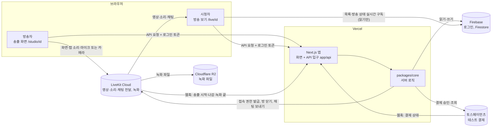
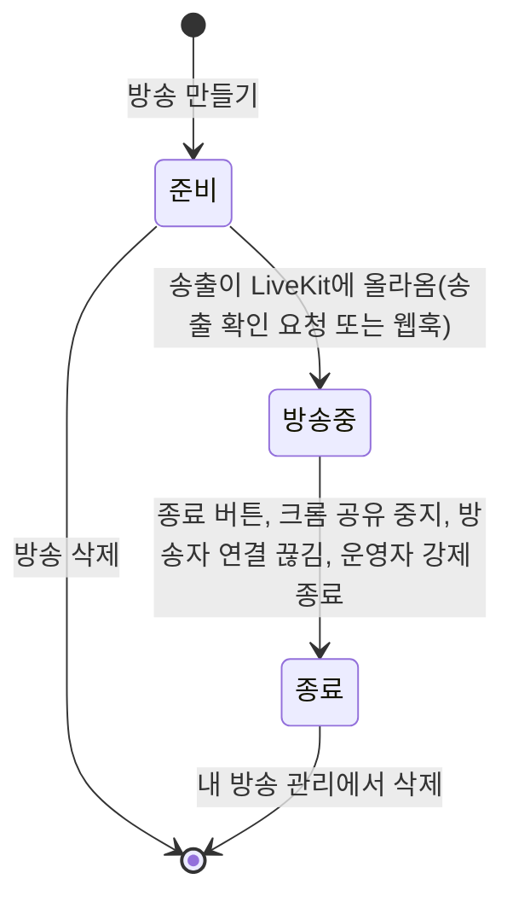
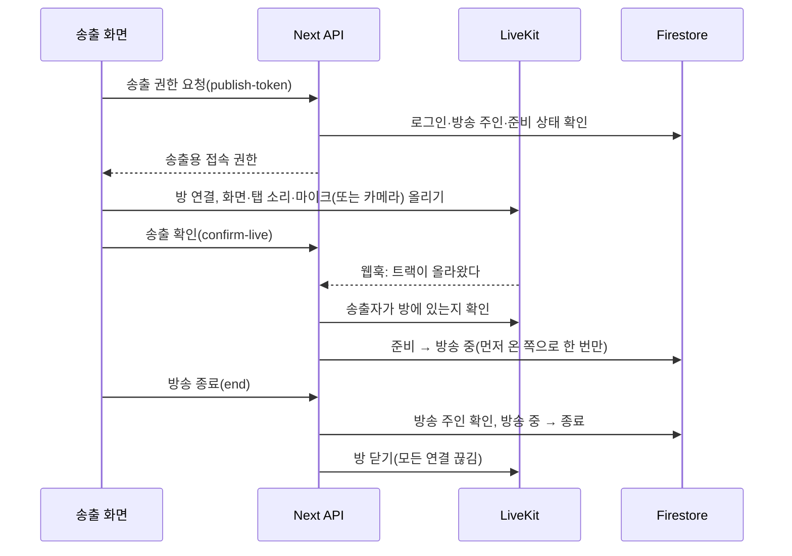

# 나비 설계(아키텍처)

- 마지막 수정: 2026-11-19
- 한 줄 요약: 나비가 어떤 서비스로 이루어지고, 코드가 어떻게 나뉘고, 방송·채팅·후원·녹화 요청이 어떤 순서로 처리되는지 한 문서에 모았다.
- 이 문서의 위치: [문서 색인](README.md)
- 결정의 이유와 비교한 후보는 [06 결정 기록](06-decisions.md)에 있다. 기능의 자세한 동작은 [07 기능 명세](07-feature-spec.md)가 기준이다. 이 문서와 두 문서가 다르면 두 문서를 따른다.

## 1. 전체 구성



| 구성 요소 | 하는 일 | 근거 |
|---|---|---|
| LiveKit Cloud | 방송자의 영상과 소리를 받아 시청자에게 나눠 준다. 채팅 전달과 녹화(egress)도 맡는다 | [06 결정 1](06-decisions.md#결정-1-송출-구조-livekit-cloud), [결정 12](06-decisions.md#결정-12-채팅은-livekit-연결로-전달하고-수정과-삭제는-만들지-않는다) |
| Vercel 위 Next.js 앱 | 화면과 API를 함께 배포한다. 항상 켜진 서버를 따로 두지 않는다 | [06 결정 2](06-decisions.md#결정-2-배포-서비스-vercel--firebase--cloudflare-r2), [결정 14](06-decisions.md#결정-14-백엔드는-next-안에-두고-서버-로직만-별도-패키지로-나눈다) |
| Firebase Authentication | 이메일·구글 로그인과 로그인 토큰을 맡는다 | [06 결정 2](06-decisions.md#결정-2-배포-서비스-vercel--firebase--cloudflare-r2) |
| Firestore | 방송, 채팅, 꿀, 후원, 녹화 정보를 저장한다. 서버를 다시 켜도 남는다 | [07 6장](07-feature-spec.md#6-데이터-구조-firestore) |
| Cloudflare R2 | 녹화 파일(MP4)을 저장한다. 재생은 서명된 주소로만 한다 | [07 4-9](07-feature-spec.md#4-9-녹화와-다시보기) |
| 토스페이먼츠 | 꿀 충전을 테스트 결제로 받는다 | [07 4-8](07-feature-spec.md#4-8-후원) |

### 지키는 원칙

- 브라우저는 Firestore에 아무것도 쓰지 못한다. 쓰기는 모두 Next 서버를 거친다. 규칙은 [`firestore.rules`](../firestore.rules)에 있다.
- 브라우저는 LiveKit 방에 채팅을 직접 보내지 못한다. 서버가 확인하고 저장한 뒤 방 전체에 보낸다.
- 로그인 확인과 소유자 확인은 화면이 아니라 서버가 한다. 화면에서 버튼을 숨기는 것은 편의일 뿐이다.

## 2. 코드 구조

pnpm 모노레포다. 배포하는 앱은 `apps/web` 하나다.

```
apps/web/                      Next.js 앱(App Router)
├─ app/                        화면 주소와 API 입구
│  ├─ live/[id]/               방송 보기
│  ├─ studio/[id]/             송출 화면(PC 화면 공유, 휴대폰 카메라)
│  ├─ replays/                 다시보기 목록과 재생
│  ├─ admin/                   운영자 화면
│  └─ api/                     API 입구: 입력 검사 → 로그인 확인 → core 호출
│     └─ webhooks/             LiveKit, 토스페이먼츠 알림 받기
└─ src/                        화면 코드(FSD 구조)
   ├─ entities/                방송, 로그인 상태
   ├─ features/                채팅, 후원, 송출, 신고, 운영자 기능
   ├─ widgets/                 헤더, 사이드바, 홈
   ├─ shared/                  공용 UI, API 호출 함수
   └─ server/route.ts          모든 API 입구가 쓰는 공용 함수(입력 검사, 오류 응답)
packages/core/src/             서버 로직(브라우저에서 불러오지 못한다)
├─ domain/                     외부 서비스 없이 도는 규칙. 단위 테스트가 여기에 있다
├─ application/                기능별 처리 순서(방송, 채팅, 꿀, 후원, 녹화, 정산, 신고·제재)
├─ adapters/                   Firestore, LiveKit, egress, R2, 토스페이먼츠 연결
└─ container.ts                연결 부품을 조립한다
packages/shared/src/           화면과 서버가 함께 쓰는 API 약속(zod 스키마), 상수, 타입
```

- API 약속은 `packages/shared`에 zod로 한 번만 적는다. 화면의 요청, 서버의 입력 검사, OpenAPI 문서(`/api-docs`)가 모두 이 약속에서 나온다([06 결정 18](06-decisions.md#결정-18-api-약속은-zod로-정하고-openapi-문서는-그-약속에서-만든다)).
- 서버 로직은 바깥 서비스와 규칙을 나눈 가벼운 헥사고날 구조다([06 결정 17](06-decisions.md#결정-17-백엔드는-가벼운-헥사고날-구조로-만든다)). 결정 17의 폴더 그림은 계획 단계의 그림이다. 실제 코드는 위처럼 영역마다 파일 하나(`domain/chat.ts`, `adapters/livekit.ts`)로 되어 있다.
- 화면 코드는 FSD 구조로 나눴다([06 결정 16](06-decisions.md#결정-16-프론트는-shadcnui와-fsd로-만든다)).

## 3. 방송 상태

방송 상태는 준비, 방송 중, 종료 세 가지다. 종료된 방송은 다시 방송 중으로 돌아가지 않는다. 자세한 표는 [07 3장](07-feature-spec.md#3-방송-상태)에 있다.



- 종료하는 길은 네 가지지만 모두 서버 함수 하나(`packages/core/src/application/broadcast.ts`의 `end`)를 부른다. 이 함수가 트랜잭션 안에서 상태 바꾸기, 녹화 상태 바꾸기, 미션 꿀 돌려주기, 방송 시간 더하기를 함께 하고, 끝나면 LiveKit 방을 닫아 송출과 시청 연결을 모두 끊는다.
- 같은 종료 요청이 두 번 와도 한 번만 처리한다. 방송 중인 방송만 종료로 바꾸기 때문이다.

## 4. 주요 흐름

### 4-1. 방송 시작과 종료



- 송출 화면은 `apps/web/app/studio/[id]/page.tsx`다. PC는 `getDisplayMedia`로 화면과 탭 소리를, `getUserMedia`로 마이크를 받는다. 휴대폰은 `getUserMedia`로 카메라와 마이크를 받는다.
- 탭 소리와 마이크는 따로 올린다. 시청 화면이 두 소리를 함께 재생한다.

### 4-2. 채팅

1. 화면이 서버에 채팅을 보낸다(`POST /api/broadcasts/:id/chat`).
2. 서버가 로그인, 방송 상태, 제재, 금칙어, 1초 도배 제한을 확인한다.
3. 서버가 Firestore에 저장하고, LiveKit으로 방 전체에 보낸다.
4. 늦게 들어온 사람은 Firestore에서 최근 50개를 읽는다.

수정과 삭제(`PATCH`, `DELETE /api/broadcasts/:id/chat/:messageId`)도 같은 길이다. 서버가 작성자 본인인지 확인하고, 바뀐 줄을 다시 방 전체에 보낸다([06 결정 32](06-decisions.md#결정-32-채팅-수정과-삭제를-만든다)).

### 4-3. 충전과 후원

1. 시청자가 충전을 고르면 서버가 주문을 만든다.
2. 토스페이먼츠 결제창에서 테스트 결제를 한다.
3. 결제 완료 화면과 토스페이먼츠 웹훅이 같은 "충전 확정" 함수를 부른다. 서버는 토스페이먼츠에 결제를 다시 조회해서 상태, 주문번호, 금액을 확인한다.
4. 이미 확정된 주문이면 아무것도 하지 않는다. 그래서 같은 승인 알림이 여러 번 와도 꿀은 한 번만 들어간다.
5. 후원은 충전한 꿀에서 빠진다. 후원마다 요청 번호를 받아서 같은 요청은 한 번만 처리한다. 방송의 후원 합계와 건수는 같은 트랜잭션에서 늘어난다.

코드는 `packages/core/src/application/honey.ts`(충전)와 `donation.ts`(후원)에 있다. 돈의 흐름 전체는 [11 수익 구조](11-business-model.md)에 있다.

### 4-4. 녹화와 다시보기

1. 방송자가 시작 전에 녹화를 켜면, 방송이 방송 중이 될 때 서버가 LiveKit egress에 녹화를 시작시킨다.
2. 방송이 끝나면 egress가 MP4를 R2에 올리고 웹훅을 보낸다.
3. 서버가 녹화 문서에 파일 위치, 길이, 상태를 저장한다. 처음에는 비공개다.
4. 방송자가 공개로 바꾸면 다시보기 목록에 나온다. 재생은 서버가 만든 서명된 주소로만 한다.

코드는 `packages/core/src/application/recording.ts`와 `adapters/egress.ts`에 있다.

## 5. 인증과 인가

| 층 | 무엇을 확인하나 | 코드 |
|---|---|---|
| 로그인 확인 | API 요청의 로그인 토큰을 Firebase로 검증하고, 사용자 문서와 영구 정지 여부를 본다 | `packages/core/src/application/auth.ts`의 `requireUser` |
| 방송 주인 확인 | 방송의 주인과 요청한 사람이 다르면 403으로 거절한다. 방송 수정, 삭제, 송출 권한, 송출 확인, 종료에 쓴다 | `packages/core/src/application/broadcast.ts`의 `loadOwned` |
| 채팅 작성자 확인 | 채팅을 쓴 사람과 요청한 사람이 다르면 403으로 거절한다 | `packages/core/src/domain/chat.ts`의 `chatChangeBlock` |
| 운영자 확인 | 운영자 표시가 있는 계정만 운영자 API를 부른다. 테스트 운영자는 심사용 계정에만 조치한다 | `packages/core/src/application/admin.ts`의 `requireAdmin` |
| 데이터베이스 규칙 | 브라우저는 방송, 채팅, 공개 녹화만 읽고 아무것도 쓰지 못한다 | [`firestore.rules`](../firestore.rules) |
| LiveKit 접속 권한 | 송출 권한은 방송 주인에게만 준다. 시청 권한은 로그인 없이 주지만 올리기와 데이터 보내기를 끈다 | `packages/core/src/adapters/livekit.ts` |
| 웹훅 확인 | LiveKit 웹훅은 서명을 확인한다. 토스페이먼츠 웹훅은 내용을 믿지 않고 결제를 다시 조회한다 | `apps/web/app/api/webhooks/` |

누가 무엇을 할 수 있는지는 [07 5장 권한 표](07-feature-spec.md#5-권한-표)에 있다.

## 6. 데이터 저장

- 컬렉션과 필드는 [07 6장](07-feature-spec.md#6-데이터-구조-firestore)에 있다. 색인은 [`firestore.indexes.json`](../firestore.indexes.json)에 있다.
- 꿀이 움직이는 처리(충전 확정, 후원, 미션, 환급, 정산)는 모두 Firestore 트랜잭션 하나 안에서 지갑, 꿀 내역, 관련 문서를 함께 바꾼다.

## 7. 테스트와 검사

| 무엇을 | 명령 |
|---|---|
| 타입 검사 | `pnpm -r typecheck` |
| 규칙 단위 테스트 | `pnpm -r test`. `packages/core/src/domain/*.test.ts`와 `packages/shared/src/rules.test.ts`다 |
| 린트 | `cd apps/web && pnpm exec eslint .` |
| 녹화 규칙 점검 | `pnpm --filter @nabi/core check-recording`. 가짜 egress와 가짜 저장소로 돌린다 |
| 서버 권한 확인 | [README의 확인용 명령](../README.md#확인용-명령)의 curl 명령 |
